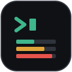
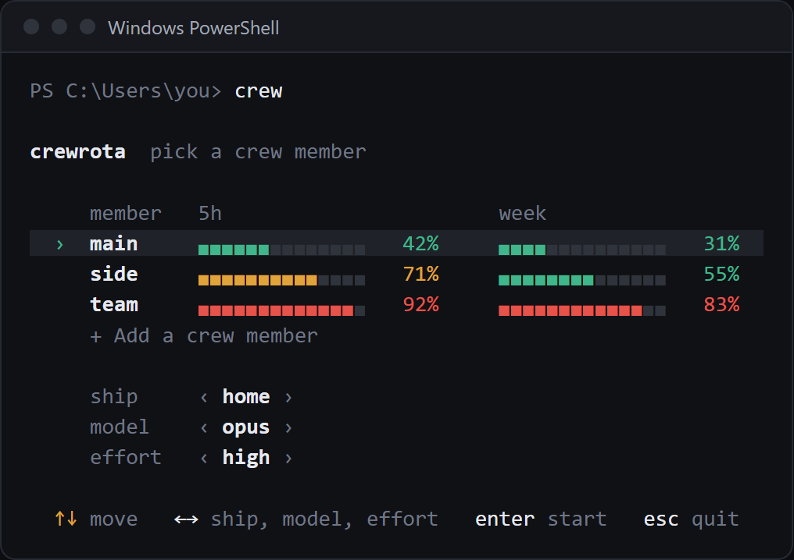
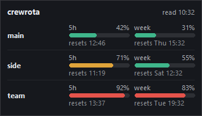

<h1 align="center">crewrota</h1>

<p align="center"></p>

<p align="center"><b>Run Claude Code as any of your crew members</b></p>

<p align="center">One Claude login per member, shared history on a ship, quota at a glance.</p>

<p align="center">
  <a href="LICENSE"></a>
  <a href="https://github.com/pasindu-premachandra/crewrota/actions/workflows/ci.yml"></a>
  <a href="https://www.npmjs.com/package/crewrota"></a>
  <a href="https://www.npmjs.com/package/crewrota"></a>
  
  <a href="https://github.com/sponsors/pasindu-premachandra"></a>
</p>

<p align="center">
  <a href="https://crewrota.pasindug.com">Website</a> |
  <a href="#install">Install</a> |
  <a href="docs/windows/quickstart.md">Windows quickstart</a> |
  <a href="docs/macos/quickstart.md">macOS quickstart</a> |
  <a href="docs/commands.md">All commands</a> |
  <a href="https://github.com/sponsors/pasindu-premachandra">Sponsor</a>
</p>

## Why

One Claude plan can run out before your work does: the 5-hour window closes mid-task, and the weekly cap lands mid-week.
If you pay for more than one login, switching means signing out, signing in and losing your place.
crewrota keeps every login signed in, carries your sessions across them and shows which one has room.



## What you get

- **One screen to start.** Type `crew`, pick a member, its model and effort, and Claude Code opens as that login. Your main `~/.claude` login is never touched.
- **Usage at a glance.** 5-hour and weekly bars for every member, in the terminal (`crew quota`) or in a small desktop widget (`crew widget`).
- **Warm-up.** `crew warmup` sends each member one short message, so its 5-hour window starts before you need it.
- **Shared history.** Members on the same ship share history and memory, so `--resume` finds a session another member started. A ship also gives its members the same MCP servers.
- **Your setup in every member.** Your skills, agents, commands, plugins, settings and `CLAUDE.md` come with every member.
- **VS Code shortcuts.** `crew shortcut add` opens a folder as a member, with a Start Menu hotkey on Windows.
- **Backup and restore.** One zip, with an optional password, moves your ships and settings to a new machine. Logins are never in it.
- **firstmate plugin.** `/firstmate <task>` hands a task to other members running in their own git worktree. Nothing is committed without your word.



## Install

You need Node 22.19 or newer and Claude Code.

```
npm install -g crewrota
crew add work
crew add personal
crew
```

`crew add` opens Claude Code's own login for that member. `crw` and `crewrota` work the same as `crew`.

To add the plugin, run this in your main Claude Code:

```
claude plugin marketplace add pasindu-premachandra/crewrota
claude plugin install crewrota@crewrota
```

Step by step: [Windows](docs/windows/quickstart.md) or [macOS (beta)](docs/macos/quickstart.md).

## Main commands

| Command | What it does |
|---|---|
| `crew` | Pick a member, model and effort, then launch Claude Code |
| `crew <member>` | Launch that member with its saved model and effort |
| `crew add <member>` | Create a member and log it in |
| `crew list` | Every member with its ship, usage and email |
| `crew quota` | 5-hour and weekly bars for every member |
| `crew widget` | The usage widget on your desktop |
| `crew warmup` | Send each member one short message to start its 5-hour window |
| `crew ship join <member> <ship>` | Share history through a ship |
| `crew shortcut add <name> --member <m>` | A VS Code shortcut for a folder and member |
| `crew backup --password` | One encrypted zip for a new machine |
| `crew doctor` | Check the setup |

Every command, the default tools and where files live: [docs/commands.md](docs/commands.md), or `crew --help`.

## Your accounts and Anthropic's terms

crewrota is for one person running their own Claude subscriptions.
Each member logs in through Claude Code's own login, and the login stays in that member's folder.
crewrota never reads, copies or ships credentials.
Read Anthropic's terms for your plan before you use several accounts:

- Consumer Terms: https://www.anthropic.com/legal/consumer-terms
- Claude Code legal and compliance: https://code.claude.com/docs/en/legal-and-compliance

## About --dangerously-skip-permissions

This Claude Code flag lets the agent edit files and run commands without asking you first.
crewrota asks once, at your first launch, whether to use it. The default is no.
Change it any time with `crew config permissions on` or `crew config permissions off`.

## License

MIT. Bug reports and ideas are welcome as [GitHub issues](https://github.com/pasindu-premachandra/crewrota/issues).

Status: Stable (1.0.3).
