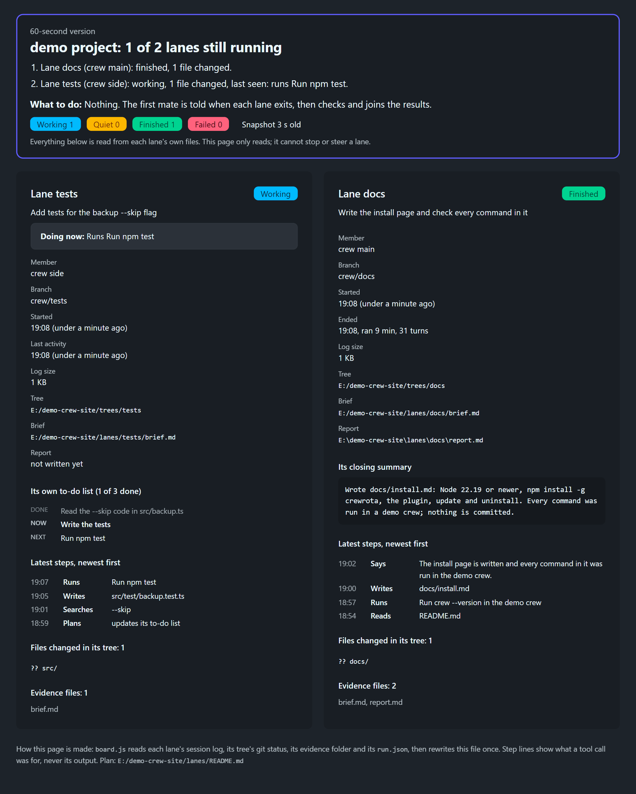

The agents board is one page with a card per lane: its member, its job, what it is doing now and its result.
`/firstmate` builds it with `node board.js <lanes.json> <out.html> [--watch 60]` from the skill folder and opens it before the first run starts.
It only reads each lane's own files, so it cannot stop or steer a lane.



## Build it

```sh
node board.js <lanes.json> <out.html | out.md> [--watch <seconds>]
```

| Argument | What it is |
|---|---|
| `<lanes.json>` | The lanes file, below |
| `<out.html>` | Where the page is written; written to a `.tmp` file first, then renamed |
| `<out.md>` | An out path ending in `.md` writes a Markdown status file instead, for sessions without Lavish |
| `--watch <seconds>` | Rebuild every so many seconds (at least 5, 60 when the number is missing) until every lane has finished or failed |

Without both paths it prints `usage: node board.js <lanes.json> <out.html | out.md> [--watch <seconds>]` and exits with 2.
Each build prints one line per lane, such as `a: working | b: finished`, and the watch prints `all lanes ended: ...` when it stops.

In the plugin, firstmate runs it as `node "${CLAUDE_SKILL_DIR}/board.js" ...`, opens the page with `npx -y lavish-axi <out.html>`, and keeps the `--watch` run going as a background job.

## The lanes file

firstmate writes it as `evidence/lanes-<yyyy-mm-dd>.json` in the task folder:

```json
{
  "title": "<task name>",
  "plan": "<absolute path to the task README>",
  "lanes": [
    { "name": "a", "member": "<member>", "ship": "<ship or omit>", "job": "<the user's ask in one plain line>", "worktree": "<the folder the lane starts in>", "evidence": "<task>/evidence/lane-a", "brief": "<task>/evidence/brief-lane-a.md" }
  ]
}
```

| Key | What the board does with it |
|---|---|
| `title` | The page heading |
| `plan` | Shown at the bottom |
| `name`, `member`, `ship`, `job` | The card's heading, facts and first line |
| `worktree` | The folder the run started in. The board finds the session log from it, and reads the tree's branch and `git status` |
| `evidence` | Where the lane's `run.json` and `report.md` are |
| `brief` | Shown on the card |

`worktree` must be the folder the run was started in.
Claude Code files a session under `<member folder>/projects/<that folder with every character other than a letter or digit as ->`, and the board reads the newest `.jsonl` there, with the crew home from `CREWROTA_HOME` or `~/.crewrota`.

A later lane on the same task is added to the same file, and the board is rebuilt.

## Lane states

| State | When |
|---|---|
| Not started | No `run.json` yet |
| Working | `run.json` exists with no result yet, and the session log changed in the last five minutes |
| Quiet | No result yet, and nothing written to the log for five minutes or more |
| Finished | `run.json` holds a result line without an error |
| Failed | `run.json` holds a result line with `is_error` set |

The board reads the last JSON line in `run.json` that has `is_error` or `"type": "result"`, so crewrota's `[i]` notes before it do not matter.
Quiet does not mean stuck: a long build or install writes nothing to the log.
The board says a lane quiet for over fifteen minutes is worth a look.

## What a card shows

- The lane's job, and while it runs, "Doing now" with its latest step.
- Member, ship, branch, when it started, when it ended (with how long it ran and its turns) or its last activity, the log size, the tree, the brief and the report.
- Its closing summary, once it has one.
- Its own to-do list, when the lane keeps one.
- Its latest seven steps, newest first: what each tool call was for (Reads, Writes, Runs, Searches, Plans, Says, Uses), never the output.
- The files changed in its tree (up to 16) and the files in its evidence folder.

At the top, a short summary: how many lanes are still running, one line per lane, what to do next, counts per state, and how old the snapshot is.
The snapshot badge turns to "not refreshing" when the page has not been rebuilt for three watch intervals, or for two minutes after a one-off build.

## The page

- Dark, with `data-lavish-annotate="off"`, so it opens in Lavish as a page to read.
- Styled with DaisyUI and Tailwind from a CDN, so the browser needs to reach `cdn.jsdelivr.net` for its look.
- Information only: no questions. A decision a lane surfaces gets its own question page.

## The Markdown version

With an out path ending in `.md`, the board writes the same summary as Markdown: a heading with how many lanes are running, the snapshot time and plan, one line per lane, what to do next, then a section per lane with its member, branch, tree, brief, report, files changed and closing summary.

## Related

- [/firstmate](firstmate.md)
- [The Lavish rule hook](lavish-hook.md)
