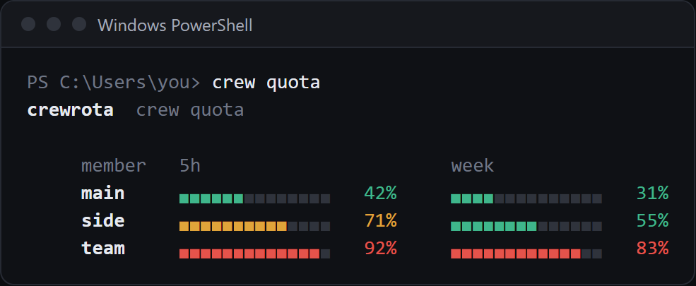
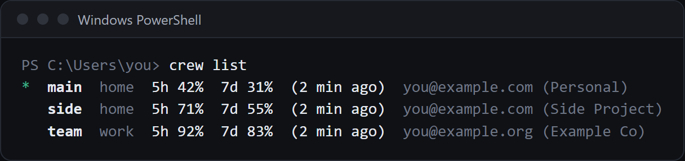
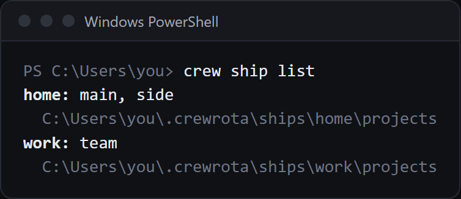
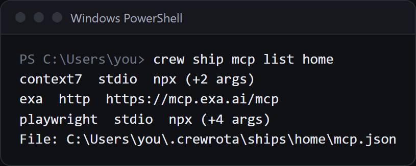
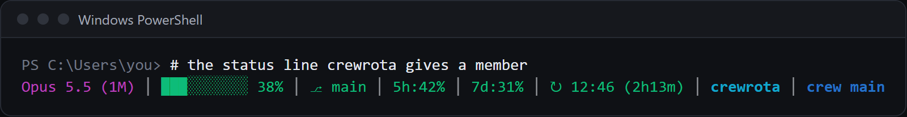

# crewrota commands and reference

Every command, the default tools, where files live, backups and how members get your main setup.
The short version is in the [README](../README.md).

## Contents

- [Commands](#commands)
- [What it looks like](#what-it-looks-like)
- [The default tools: crew setup](#the-default-tools-crew-setup)
- [The Claude Code plugin: firstmate and the Lavish rule](#the-claude-code-plugin-firstmate-and-the-lavish-rule)
- [Where things live](#where-things-live)
- [Moving to a new machine](#moving-to-a-new-machine)
- [Your main setup in every member](#your-main-setup-in-every-member)

## Commands

`crw` and `crewrota` do exactly what `crew` does.

| Command | What it does |
|---|---|
| `crew` | Menu: pick a member (or add one), its ship, a model and an effort on one screen, then launch Claude Code as that member |
| `crew use <member>` | Make `<member>` the current one; if it does not exist, crew offers to create it |
| `crew use -` | Go back to the previous member |
| `crew add <member> [--ship <s>] [--email <e>] [--sso]` | Create a member and log it in with Claude Code's own login |
| `crew run [<member>] [-- <args>]` | Launch Claude as `<member>`, else `$CREW_MEMBER`, else the current member; arguments after `--` go to Claude |
| `crew <member> [-- <args>]` | The same as `crew run <member>`: the member's saved model, effort and ship |
| `crew list` or `crew ls` | Members with `*` on the current one, ship, usage, email and organisation |
| `crew whoami` | The current member: folder, ship, email, organisation, logged in or not |
| `crew statusline` | The status line crewrota gives members without one: saves the session's usage to `quota.json` and prints one line |
| `crew quota` | Every member's 5-hour and week use as bars, read fresh with quota-axi first unless `crew config refresh off` |
| `crew quota --format menubar` | The same in the SwiftBar and xbar text format, read from each member's last reading without checking usage; `widget/crewrota.1m.sh` runs it in the macOS menu bar (beta) |
| `crew warmup [<member>...]` | Send every member (or the ones named) one short Haiku message, which starts its 5-hour window if none is running, then show the bars |
| `crew widget` | Open the quota widget: every member's bars in a small always-on-top window, with today's token count across the crew, the clock, a button that warms up every member and a coding-music link (needs Python 3 with Tk) |
| `crew widget close` | Close it |
| `crew widget startup on\|off` | Open the widget at login, or stop that (Windows) |
| `crew current` | The current member's name only (exit code 1 when there is none) |
| `crew login <member>`, `crew logout <member>` | Log a member in or out again; its folder stays |
| `crew rename <old> <new>` | Rename a member |
| `crew drop <member> [--force] [--yes]` | Drop a member: its folder moves to `removed/` (refuses the current member unless `--force`); `crew remove` works too |
| `crew shortcut add <name> --member <m> [--folder <path>] [--hotkey <keys>]` | A VS Code shortcut: a workspace file that opens the folder (the current one by default) and runs `crew <m>` there; on Windows also a Start Menu entry, with an optional hotkey such as `CTRL+ALT+C` |
| `crew shortcut list` | The shortcuts with their member, folder and hotkey |
| `crew shortcut set <name> [--member <m>] [--folder <path>] [--hotkey <keys>\|--no-hotkey]` | Change only the given parts of a shortcut and write its files again |
| `crew shortcut remove <name>` | Delete a shortcut's workspace file and Start Menu entry |
| `crew shortcut open <name>` | Open a shortcut in VS Code |
| `crew ship create <ship>` | Make an empty ship |
| `crew ship list` | Ships and their members |
| `crew ship rename <old> <new>` | Rename a ship; its members follow |
| `crew ship mcp list\|add\|remove <ship> ...` | The ship's MCP servers, which its members get at launch |
| `crew ship import <ship> --from <folder>` | Copy history, memory and session folders into the ship (a ccs context group folder works); run it again to add what is new |
| `crew ship delete <ship> [--force] [--yes]` | Move a ship's folder to `removed/` (refuses while members are aboard unless `--force`) |
| `crew ship join <member> <ship>` | Share `<member>`'s history through `<ship>`; its existing history is copied in |
| `crew ship leave <member>` | Make `<member>` isolated again; the ship keeps its files |
| `crew backup [--to <folder>] [--password]` | One zip of every ship (history, memory, session folders, MCP servers), the member list and the remembered settings; never a login |
| `crew restore <zip> [--map <old>=<new>]... [--password]` | Bring a backup back: ships merged in, missing members re-created, project folders renamed to this machine's paths; then `crew login <member>` for each |
| `crew config permissions on\|off` | Start sessions with `--dangerously-skip-permissions`, or not |
| `crew config refresh on\|off` | Read every member's usage with quota-axi as the menu opens; no message is sent (on by default) |
| `crew config lavish on\|off` | Add the plugin's Lavish rule at every session start, or stop that (on by default) |
| `crew config show` | Remembered settings |
| `crew setup [--yes] [--with-hooks]` | Install the default tools from upstream: one list with each command and where it lands, one yes; anything installed is skipped, never updated |
| `crew init` | Write the project's root `.claude/` folder into the current folder; never overwrites a file |
| `crew doctor [--logins]` | Check Node, Claude Code, the folders, every link and each default tool; `--logins` also asks Claude Code whether each member is logged in |
| `crew --help`, `crew --version` | Help and version |

Member and ship names use lowercase letters, digits and hyphens, start with a letter, and are at most 32 characters.

## What it looks like

Every member's usage, as bars in the terminal (`crew quota`) or in a small window on your desktop (`crew widget`):




Your crew at a glance (`crew list`), and the ships they share (`crew ship list`, `crew ship mcp list <ship>`):







The status line crewrota gives a member that has none of its own:



The screenshots use a demo crew with example names, accounts and usage.

## The default tools: crew setup

`crew setup` prints one list, each tool with the exact command it runs and where it lands, and asks once.
Anything already installed is skipped and never updated in place.
`--yes` skips the question; without a terminal and without `--yes` it refuses.

| Tool | Command | Lands in |
|---|---|---|
| lavish skill | `npx skills add kunchenguid/lavish-axi --skill lavish -g` | `~/.claude/skills/lavish` |
| gh-axi skill | `npx skills add kunchenguid/gh-axi --skill gh-axi -g` | `~/.claude/skills/gh-axi` |
| quota-axi skill | `npx skills add kunchenguid/quota-axi --skill quota-axi -g` | `~/.claude/skills/quota-axi` |
| treehouse | `irm https://kunchenguid.github.io/treehouse/install.ps1 \| iex` (Windows), `curl -fsSL https://kunchenguid.github.io/treehouse/install.sh \| sh` (elsewhere) | the `treehouse` command on your PATH |
| Playwright CLI | `npm install -g @playwright/cli@latest`, then `playwright-cli install --skills` (from your home folder) | the `playwright-cli` command and its skill |
| Playwright MCP | adds `playwright` (`npx -y @playwright/mcp@latest`) to each ship's `mcp.json` that has none | `~/.crewrota/ships/<ship>/mcp.json` |

Skills land in `~/.claude/skills`, which every member links.
After the installs it checks `gh auth status` and only reports it: sign in to GitHub yourself with `gh auth login`.
It also asks once whether lavish-axi may send its usage telemetry; a no is remembered, and every launch then passes `LAVISH_AXI_TELEMETRY=0`.
`--with-hooks` also runs `npm install -g gh-axi lavish-axi`, then `gh-axi setup hooks` and `lavish-axi setup hooks` (opt-in session hooks).
`crew doctor` shows each tool as installed or missing, with the command that installs it.

## The Claude Code plugin: firstmate and the Lavish rule

The repo is also a Claude Code plugin marketplace with one plugin, `crewrota`:

```
claude plugin marketplace add pasindu-premachandra/crewrota
claude plugin install crewrota@crewrota
```

Run these in your main Claude Code, not inside a member: every member links your main plugin cache and copies its plugin lists at launch.

- **firstmate** (`/firstmate <task>`): runs a task through one or more crew members working headless. It reads the project's root `.claude/`, asks its questions on a Lavish page, writes the PRD and task list into the task's README, opens the agents board before the first dispatch, picks each member by rule and live quota (quota-axi), gives every lane its own tree (a treehouse lease, else a plain git worktree), checks and validates each result, drafts the ticket update in `evidence/ticket-update.md` for you to paste (it never posts), and writes what it learned into `.claude/memories/`. Nothing is committed, merged or published without your word.
- **The Lavish rule**: a SessionStart hook that tells every session to put a question with options on a Lavish page in the task's `review/` folder, keep one-line facts in chat, and never share a page without your word. `crew config lavish off` turns it off.

`crew init` in a project writes the root `.claude/` firstmate reads: `crewrota.json` (marks the root), a short `CLAUDE.md` only if the project has none, `memories/README.md`, `skills/` and `tasks/INDEX.md`.

## Where things live

| What | Windows | macOS |
|---|---|---|
| Members | `%USERPROFILE%\.crewrota\members\<member>` | `~/.crewrota/members/<member>` |
| Ships | `%USERPROFILE%\.crewrota\ships\<ship>\projects` | `~/.crewrota/ships/<ship>/projects` |
| Removed members and ships | `%USERPROFILE%\.crewrota\removed` | `~/.crewrota/removed` |
| Remembered settings | `%APPDATA%\crewrota\config.json` | `~/.config/crewrota/config.json` |

Set `CREWROTA_HOME` to keep members and ships somewhere else.
crewrota never deletes a member or a ship: `remove` and `ship delete` move the folder to `removed/`, and you delete it yourself when you are sure.

## Moving to a new machine

```
crew backup --password
crew restore crewrota-backup-20261026-0905.zip --password
```

`crew backup` writes one zip in the current folder (or `--to <folder>`): every ship with its history, memory, session folders and MCP servers, the member list with each member's ship, model and effort, and the remembered settings.
Logins are never in it: after `crew restore`, sign each member in again with `crew login <member>`, and the restore prints that line for every member it made.
`crew restore` merges the ships into the ones you have, re-creates the members you are missing, and leaves your existing members and settings alone.
Claude Code files each session under its project's full folder path, so the restore renames those folders when your home folder differs on the new machine.
For projects that moved elsewhere, add `--map <old folder>=<new folder>`, for example `--map E:\Projects=D:\work`; it renames that folder and every folder below it, and you can repeat it.
The zip holds your transcripts and the ships' MCP keys in plain text, so use `--password` to encrypt it with AES-256; without a terminal crewrota reads the password from `CREWROTA_BACKUP_PASSWORD`.
The zip is written and read by bsdtar, which Windows 10 and 11 and macOS already have; on Linux install `libarchive-tools`.

## Your main setup in every member

Before every launch crew links each member's `skills`, `agents` and `commands` to the ones in `~/.claude`, gives it a `plugins` folder whose cache, data and marketplaces are links to yours (the layout ccs uses), and copies `~/.claude/settings.json` and `~/.claude/CLAUDE.md` into it.
It only reads your main setup; it never writes to `~/.claude` or `~/.claude.json`.

MCP servers come from the member's ship: `crew ship mcp list|add|remove <ship> ...` manages them, kept in that ship's `mcp.json` beside the logins, and a new ship starts with a copy of the ones in `~/.claude.json`.
A member with no ship gets the ones in `~/.claude.json`.
For servers that belong to one repo, use Claude Code's own `.mcp.json` in that repo (`claude mcp add --scope project`), with keys written as `${VAR}` and set in your shell before `crew`.

