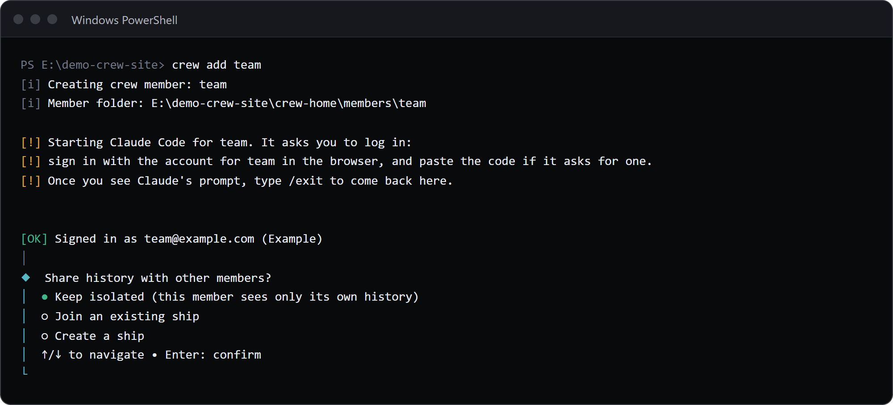
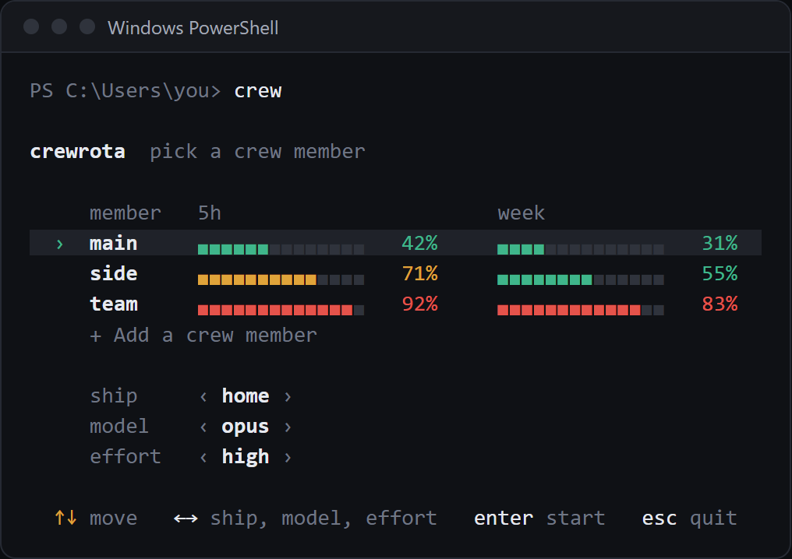
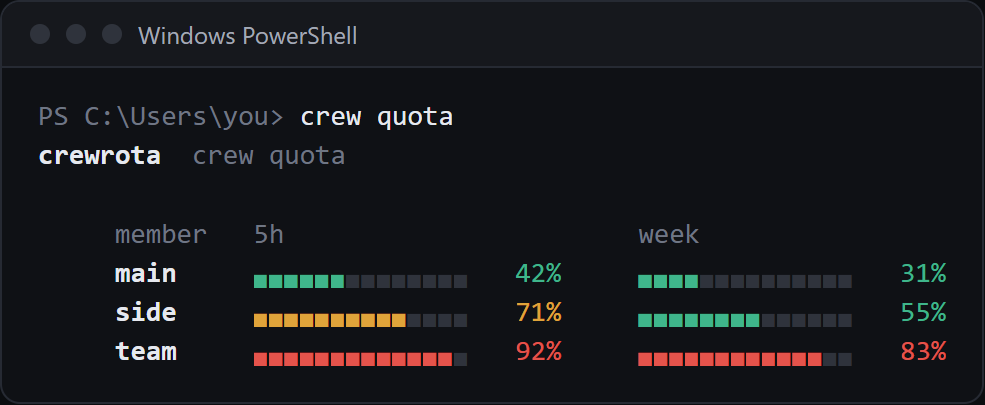

Add two members with `crew add main` and `crew add side`, put them on one ship with `crew ship join <member> home`, then type `crew` to pick a member and start Claude.
`crew quota` shows every member's 5-hour and week use.
This page uses the example names `main`, `side` and `home`; pick your own.
It assumes crewrota is installed ([Install crewrota](install.md)).

## Add your first member

Run this in a terminal:

```sh
crew add main
```

crew makes the member folder (`~/.crewrota/members/main`, or `%USERPROFILE%\.crewrota\members\main` on Windows) and starts Claude Code inside it.
Claude Code asks you to log in: sign in with that member's account in the browser, paste the code if it asks for one, and type `/exit` once you see Claude's prompt.
crew then checks the login, prints `Signed in as <email> (<organisation>)` and asks one question:



Pick **Keep isolated** for now; the next steps put both members on a ship.
The first member you add becomes the current member.

`crew add` needs a terminal, because Claude Code's login is interactive.
Without one it stops with `crewrota: Adding a crew member needs a terminal. It runs Claude Code's own login.`

## Add a second member

```sh
crew add side
```

Sign in with a different account.
If you sign in to the same account another member already uses, crew warns `[!] Crew member main is already signed in as main@example.com (personal).`
See [Add and manage crew members](guides/members.md) for `--sso`, `--email` and what happens when a login fails.

Check your crew:

```sh
crew list
```

```text
*  main  isolated  no reading yet  main@example.com (personal)
   side  isolated  no reading yet  side@example.com (personal)
   team  isolated  no reading yet  team@example.com (Example Co)
```

This is a demo crew with a third member, `team`.
`*` marks the current member; "no reading yet" fills in after a member's first usage reading.

## Share history on a ship

A ship lets members see each other's sessions, so `--resume` in one member finds a session another member started.

```sh
crew ship create home
crew ship join main home
crew ship join side home
```

```text
Created ship home: E:\demo-crew-pages1\crew-home\ships\home\projects
```

```text
main shares history through ship home.
```

If a member already has history, crew copies it into the ship and keeps the original beside it, printing `[i] Copied this member's history into the ship. The original folder is kept at ...`.
See [Share history between members with a ship](guides/ships.md).

## Start Claude from the menu

```sh
crew
```



| Key | What it does |
|---|---|
| Up and down, or 1 to 9 | Pick the member |
| Tab (Shift+Tab back) | Pick the setting: ship, model or effort |
| Left and right | Change that setting |
| Enter | Start Claude as that member |
| Esc | Quit; crew prints `Nothing launched.` |

The settings line offers:

- **Ship:** `isolated` or any ship. Picking another ship joins or leaves it before Claude starts.
- **Model:** Claude's default, `fable`, `opus`, `sonnet`, or "type a name", which asks `Model name (an alias or a full model name)`.
- **Effort:** Claude's default, `low`, `medium`, `high`, `xhigh` or `max`.

Each member remembers its last model and effort.
`+ Add a crew member` under the members runs the same steps as `crew add`.
With no members yet, or with the `ACCESSIBLE` environment variable set (to anything but empty, `0` or `false`), the menu asks step by step instead, which works better with a screen reader.

The first time you start a member, crew asks once whether sessions should skip Claude Code's permission prompts; the default is no.
See [Choose whether Claude asks for permission](guides/permissions.md).

## Start a member without the menu

```sh
crew main
```

This is short for `crew run main` and uses the member's saved ship, model and effort.
Claude Code's own flags go after `--`:

```sh
crew main -- --resume <session id>
```

Without the `--`, crew reads the flag as its own and stops:

```text
crewrota: Unknown option: --resume
```

## Check every member's usage

```sh
crew quota
```

```text
crewrota  crew quota

     member   5h                       week
     main     ▖▖▖▖▖▖▖▖▖▖▖▖▖▖   30%     ▖▖▖▖▖▖▖▖▖▖▖▖▖▖   55%
     side     ▖▖▖▖▖▖▖▖▖▖▖▖▖▖   30%     ▖▖▖▖▖▖▖▖▖▖▖▖▖▖   55%
     team     ▖▖▖▖▖▖▖▖▖▖▖▖▖▖   30%     ▖▖▖▖▖▖▖▖▖▖▖▖▖▖   55%
```

In a terminal the bars are coloured green, amber and red; this copy was piped, so only the percentages carry the reading.
`crew quota` reads usage with quota-axi and sends no message.
To start an idle member's 5-hour window, `crew warmup` sends each member one short message; it is the only command that sends one.
See [Check every member's usage](guides/usage-and-quota.md).



## Next

- [Give a ship's members the same MCP servers](guides/mcp-servers.md)
- [Keep usage on your desktop with the widget](guides/widget.md)
- [The crew menu and crew run, in full](reference/menu-and-run.md)
