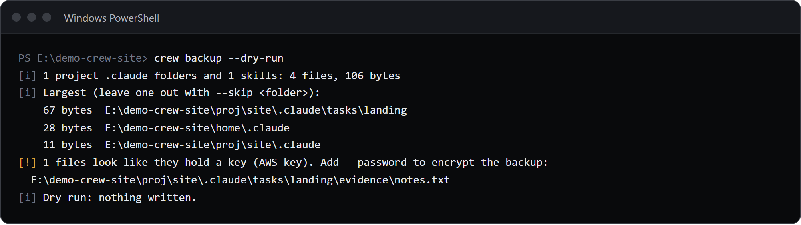
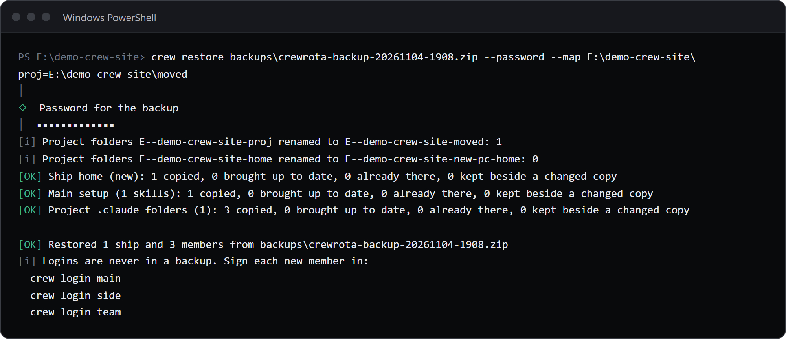

`crew backup --password` writes one encrypted zip with your ships, member list, settings, skills and every project's `.claude` folder.
On the new machine, `crew restore <zip> --password` merges it in, then prints one `crew login <member>` line for each member to sign in again.
Logins are never in a backup.

## Check first with a dry run

```sh
crew backup --dry-run
```

```text
[i] 1 project .claude folders and 1 skills: 8 files, 1.1 KB
[i] Largest (leave one out with --skip <folder>):
      1.0 KB  E:\demo-crew-inventory\proj\site\.claude
    43 bytes  E:\demo-crew-inventory\home\.claude
    37 bytes  E:\demo-crew-inventory\proj\site\.claude\tasks\landing
[!] 1 files look like they hold a key (AWS key). Add --password to encrypt the backup:
  E:\demo-crew-inventory\proj\site\.claude\tasks\landing\evidence\notes.txt
[i] Dry run: nothing written.
```



The dry run prints the same report as a real backup and writes nothing.
It names:

- how many project `.claude` folders and skills go in, and their size;
- the five largest folders, so you can leave one out with `--skip`;
- any file that looks like it holds a key (by the shape of AWS, GitHub, GitLab, Anthropic, OpenAI, Slack, Stripe live, npm and Google API keys, and private key blocks). The check is best effort and prints the file name, never the value;
- every git repo you worked in that has changed files, commits that are not pushed, or no remote, with `Only pushed code comes back on a new machine.`;
- the ships whose MCP servers would go in with their keys in plain text.

## Write the backup

```sh
crew backup --password
```

crew asks for the password twice, hidden, and writes `crewrota-backup-<date>-<time>.zip` in the current folder (or in `--to <folder>`).
The same demo crew with `--password`, the password given through `CREWROTA_BACKUP_PASSWORD`:

```text
[OK] Backup written: E:\demo-crew-inventory\out2\crewrota-backup-20261104-1827.zip
[i] 8.9 KB, 1 ship, 2 members, encrypted
[i] 1 project .claude folders and 1 skills: 8 files, 1.1 KB
[i] Largest (leave one out with --skip <folder>):
      1.0 KB  E:\demo-crew-inventory\proj\site\.claude
    43 bytes  E:\demo-crew-inventory\home\.claude
    37 bytes  E:\demo-crew-inventory\proj\site\.claude\tasks\landing
[i] No login is in it: after a restore, each member signs in again with crew login <member>.
```

The key warning is gone because the zip is encrypted.

| Option | What it does |
|---|---|
| `--to <folder>` | Write the zip there instead of the current folder |
| `--password` | Encrypt the zip with AES-256 |
| `--skip <folder>` | Leave out a project, or any folder inside a `.claude`; repeat it for more. A folder that does not exist gets `[!] --skip <folder>: no such folder.` |
| `--no-context` | Write only the ships, members and settings, without project `.claude` folders or skills |
| `--dry-run` | Print the report and write nothing |

Use `--password`: the zip holds your transcripts, task notes and the ships' MCP keys.
File and folder names inside the zip stay readable even with a password.
Without a terminal, crew reads the password from `CREWROTA_BACKUP_PASSWORD`; with neither it stops with `--password needs a terminal, or the password in CREWROTA_BACKUP_PASSWORD.`

If a zip with that name already exists (two backups in one minute), crew stops with `<file> already exists. Wait a minute, or pick another folder with --to.`

> **Note:** `--dry-run --no-context` still gathers and reports the project folders, so it is not a preview of a `--no-context` backup. A real `--no-context` backup leaves them out.

## What goes in

You do not list anything.
crew reads the folders Claude Code worked in from your transcripts and `.claude.json` files, takes every `.claude` in those folders and above them, and looks up to six levels below the top-most of them.

- **Goes in:** every ship (history, memory, session folders and its `mcp.json`), the member list with each member's ship, model and effort, your remembered settings, each project's `.claude` (tasks with their evidence, memories, skills, rules), a `CLAUDE.md` beside it that git does not track, and from `~/.claude` your skills, agents, commands and `CLAUDE.md`. Linked skills are stored as real files.
- **Stays behind:** every login and member folder; files that hold logins or keys by name (`.credentials*`, `.env` and `.env.*` other than `.env.example`, `.env.sample` and `.env.template`, `.netrc`, `.npmrc`, `id_rsa*` and similar, `*.pem`, `*.key` and similar); `settings.local.json`; `node_modules`, `.git`, `worktrees`, `.venv` and similar folders; linked git worktrees; `~/.claude/settings.json`; folders in `skills` with no `SKILL.md`; and the history of a member that is on no ship.
- **Plugins** are not copied; the restore lists the ones you had, with the command to install each.

A file or folder name outside plain ASCII is stored as `~crew1`, `~crew2` and so on, because the tar that newer Windows ships crashes on such names; the restore puts the real names back.

In a terminal, progress bars show each long step; piped output and `CI=true` stay plain.

## Restore on the new machine

Install crewrota on the new machine, copy the zip there, then:

```sh
crew restore E:/demo-crew-inventory/out2/crewrota-backup-20261104-1827.zip --password --map E:\demo-crew-inventory\proj=E:\demo-crew-inventory\moved
```

```text
[i] Project folders E--demo-crew-inventory-proj renamed to E--demo-crew-inventory-moved: 1
[i] Project folders E--demo-crew-inventory-home renamed to E--demo-crew-inventory-home2: 0
[OK] Ship home (new): 2 copied, 0 brought up to date, 0 already there, 0 kept beside a changed copy
[OK] Main setup (1 skills): 1 copied, 0 brought up to date, 0 already there, 0 kept beside a changed copy
[OK] Project .claude folders (1): 7 copied, 0 brought up to date, 0 already there, 0 kept beside a changed copy

[OK] Restored 1 ship and 2 members from E:/demo-crew-inventory/out2/crewrota-backup-20261104-1827.zip
[i] Logins are never in a backup. Sign each new member in:
  crew login main
  crew login side
```



Then run each `crew login <member>` line to sign that member in.

### What a restore does

1. **Renames project folders.** Claude Code files each session under its project's full path, with every character but a letter or digit made a hyphen. The restore renames those folders from the old home folder to this one, and by each `--map <old folder>=<new folder>` you give. A `--map` covers that folder and everything below it; repeat it for more.
2. **Merges each ship** into the one you have, or creates it. New files are copied, the same file is left alone, a transcript that only grew is brought up to date, and a file that changed on both sides arrives beside yours with `.incoming-1` before its extension. MCP servers your ship lacks are added; yours are kept.
3. **Re-creates missing members** with no login. Members you already have are left alone (`[i] Already here, left alone: main, side`).
4. **Fills settings you have not set** from the backup; settings you have set are kept.
5. **Adds your skills, agents, commands and `CLAUDE.md`** to `~/.claude`, never overwriting a file. A skill that is a link on this machine is left alone. This is the only time crewrota writes to `~/.claude`.
6. **Puts each `.claude` back** in its project folder, with the same merge rule. A folder with no place on this machine (a drive that does not exist here) is named, and waits for `--map`.
7. **Lists your repos and plugins.** Without `--clone`, each repo whose code is missing prints `Code not here yet: <folder> (<remote>). Add --clone to fetch it.`; plugins print as `claude plugin install <plugin>` lines.

Running a restore again is safe: what is already there is counted as "already there".

### Get the code too

```sh
crew restore crewrota-backup-20261026-0905.zip --password --clone --map E:\Projects=D:\work
```

With `--clone`, each repo is cloned from its `origin` with your own git login, into an empty folder or one that holds only `.claude` or `CLAUDE.md`, and its `.claude` is laid over the clone.
A tracked `.claude` file that differs from the remote shows as modified in `git status`.
A repo that is already there is left alone, and a folder that holds other files is not cloned into.

### Restore errors

| Problem | crew says |
|---|---|
| Encrypted, no `--password` | `<zip> is encrypted. Add --password.` |
| Wrong password | `The password does not open <zip>.` |
| A bad `--map` | `--map takes <old folder>=<new folder>.` |
| Not a crewrota backup | `<zip> is not a crewrota backup: it has no manifest.json.` |
| A newer backup format | `<zip> has backup format N; this crewrota reads formats 1 and 2. Update crewrota and try again.` |
| A link inside the zip | `The backup holds a link (<path>), so crewrota restored nothing from it.` |

A `.claude` can hold hooks and settings that run on your machine, so restore only a backup you made yourself.

## The zip tool

crewrota writes and reads the zip with bsdtar, never another `tar`:

| Platform | bsdtar |
|---|---|
| Windows 10 and 11 | `%SystemRoot%\System32\tar.exe`, already there |
| macOS | already there |
| Linux | install `libarchive-tools` (Debian and Ubuntu) |

`CREWROTA_TAR` points crewrota at another bsdtar.
Without one: `crewrota needs bsdtar to write and read a backup zip (on Linux, install libarchive-tools).`

## Related

- [Backup and restore, every flag and message](../reference/backup-and-restore.md)
- [Share history between members with a ship](ships.md)
- [Linux quickstart (beta)](../linux/quickstart.md)
