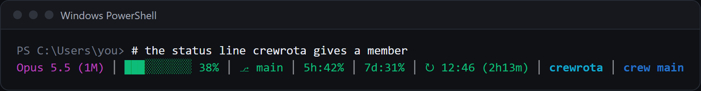

You keep one setup, your main `~/.claude`, and every member uses it.
Before every launch crewrota links each member's `skills`, `agents` and `commands` to yours, links your plugin folders, and copies your `settings.json` and `CLAUDE.md` into the member.
Install a skill or plugin once in your main Claude Code and every member has it at its next launch.

## What each member gets

| From `~/.claude` | How | When you change it |
|---|---|---|
| `skills/`, `agents/`, `commands/` | Linked (a junction on Windows, a symlink elsewhere) | Every member sees it at once |
| `plugins/cache`, `plugins/data`, `plugins/marketplaces` | Linked | Every member sees it at once |
| `plugins/installed_plugins.json`, `blocklist.json`, `install-counts-cache.json` | Copied | At each member's next launch |
| `plugins/known_marketplaces.json` | Copied, with each install path pointed at the member's own `plugins` folder | At each member's next launch |
| `settings.json`, `CLAUDE.md` | Copied | At each member's next launch |

Only what exists in `~/.claude` is linked or copied.
A member's login, history and `.claude.json` stay its own.

MCP servers come from the member's ship, not from `~/.claude`; see [Give a ship's members the same MCP servers](mcp-servers.md).

## Your main setup is read, never written

crewrota only reads `~/.claude` and `~/.claude.json`.
The one exception is `crew restore`, which adds skills, agents, commands and `CLAUDE.md` to `~/.claude` without overwriting a file.
Nothing ever writes to `~/.claude.json`.

So:

- Install plugins in your main Claude Code (`claude plugin install ...`), not inside a member.
- Edit `~/.claude/settings.json` or `~/.claude/CLAUDE.md`, not the member's copies; a member's copy is replaced at its next launch.
- crewrota never writes through a link. If a member's `settings.json`, `CLAUDE.md`, `.claude.json` or `plugins` is itself a link, the launch stops with `<file> is a link, and crewrota only writes a member's own files. Remove the link and launch again.`

## A member that had its own plugins

The first time a member uses your main plugins, crewrota moves its own `plugins` folder aside and says so: `[i] This member now uses your main plugins. Its own plugins folder is kept at <member folder>/plugins.before-crewrota-<date>`

Nothing is deleted; remove that folder yourself once you are sure you do not need it.

## When a link cannot be made

If the member has its own non-empty `skills`, `agents` or `commands` folder where the link should go, the launch stops with `<member folder>/skills is in the way of the link to ~/.claude/skills. Move it somewhere else and launch again. Nothing launched.`

An empty folder is replaced by the link without asking.
`crew doctor` shows each link's state: `linked to your main setup`, `is linked at the next launch`, `is a folder, not a link`, `points at a folder that does not exist` or `points at a different folder`.
See [Fix a problem with crew doctor](troubleshooting.md).

## The status line

Claude Code shows a status line under the prompt.
A member whose `settings.json` has no `statusLine` gets crewrota's at launch:

```text
{
  "statusLine": {
    "type": "command",
    "command": "crewrota statusline"
  }
}
```

Since `settings.json` is copied from `~/.claude` first, a status line in your main settings wins, and crewrota adds nothing.

`crew statusline` prints one line: the model, a context bar, the git branch, 5-hour and week use, the 5-hour reset with a countdown, the folder and the crew member.
From a demo session, with `NO_COLOR` set:

```text
Opus 5.5 (1M) | ███░░░░░░░ 37% |  main | 5h:42% | 7d:63% | ↻ 15:30 (0m) | crewrota | crew team
```



- Colours: green under 50%, yellow from 50%, red from 80%. These differ from the usage bars elsewhere, which turn amber at 60%.
- `NO_COLOR` turns colour off and separates the parts with ` | `.
- It never fails, so the status line never shows an error.
- Each time it runs it saves the session's usage to the member's `quota.json`, which the crew menu, `crew list`, the widget and the menu bar read. An older session cannot overwrite a newer reading.

To use your own status line in every member, set `statusLine` in `~/.claude/settings.json`.
Your own status line does not save readings for crewrota; the crew menu and `crew quota` still take their own with quota-axi.

## Related

- [What happens when a member launches](../concepts/launch.md)
- [Members, ships and your main setup](../concepts/members-and-ships.md)
- [Usage commands, in full](../reference/usage.md)
