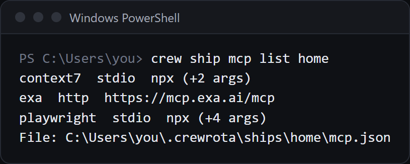

Each ship keeps one list of MCP servers in its `mcp.json`, and every member on the ship gets that list at each launch.
Add one with `crew ship mcp add <ship> <name> --url <url>` for a remote server, or `crew ship mcp add <ship> <name> -- <command> [args]` for a local one.
At every launch crewrota replaces the member's own MCP list with the ship's, so add servers to the ship, not inside the member.

## Add a remote server

```sh
crew ship mcp add home docs --url https://mcp.example.com/mcp --header "Authorization: Bearer EXAMPLE"
```

```text
Added docs to ship home. Its members get it at their next launch.
```

| Flag | What it sets |
|---|---|
| `--url <url>` | The server's address |
| `--transport <type>` | The server's `type` in `mcp.json`; the default is `http`. Use it for another transport, such as `sse` |
| `--header "Name: value"` | One request header; repeat it for more |

With `--transport`:

```sh
crew ship mcp add home events --url https://mcp.example.com/sse --transport sse
```

```text
Added events to ship home. Its members get it at their next launch.
```

## Add a local server

Put the command after `--`:

```sh
crew ship mcp add home files --env ROOT=/tmp -- npx -y @example/files-mcp /tmp
```

```text
Added files to ship home. Its members get it at their next launch.
```

`--env KEY=value` sets one environment variable for the server; repeat it for more.
The server is saved with type `stdio`.

## Copy a server from another config file

```sh
crew ship mcp add home docs --from ~/.claude.json
```

This copies the server named `docs` from that file's `mcpServers`, keys included.
If the file has no such server: `<file> has no MCP server docs`.

## List a ship's servers

```sh
crew ship mcp list home
```

```text
docs  http  https://mcp.example.com/mcp
files  stdio  npx (+3 args)
File: E:\demo-crew-inventory\crew-home\ships\home\mcp.json
```

The list never prints headers, environment values or the part of a URL after `?`, which is where keys usually sit.
With none: `Ship home has no MCP servers. Add one with: crew ship mcp add home <name> ...`



## Remove a server

```sh
crew ship mcp remove home files
```

```text
Removed files from ship home. Its members lose it at their next launch.
```

## Your member's own MCP list is replaced at launch

Before every launch, crewrota writes the ship's servers into the member's `.claude.json` as its `mcpServers`, replacing what was there.
So a server you add inside a member with `claude mcp add --scope user` is gone at that member's next launch.
Add it to the ship instead, with `crew ship mcp add`.

An isolated member (on no ship) gets the servers from your main `~/.claude.json` instead, when that file has any.

For a server that belongs to one repo, use Claude Code's own `.mcp.json` in that repo (`claude mcp add --scope project`); crewrota does not touch it.
Write its keys as `${VAR}` and set the variable in your shell before you run `crew`.

## Keys stay on your machine

`mcp.json` holds the servers' keys as you gave them, in the ship's folder (`~/.crewrota/ships/<ship>/mcp.json`), with mode 0600 on macOS and Linux.
`crew backup` includes each ship's `mcp.json` and warns when there is no password:

```text
[!] The backup holds the MCP servers of home with their keys in plain text. Add --password to encrypt it.
```

## Errors

| You ran | crew says |
|---|---|
| Both `--url` and a command | `Give either --url or a command after --, not both.` |
| Neither | `Give --url <url> for an HTTP server, or -- <command> [args] for a local one.` |
| `--header` without a colon | `--header takes "Name: value".` |
| `--env` without `=` | `--env takes KEY=value.` |
| A missing ship | `Ship <ship> doesn't exist` |
| Removing a name the ship lacks | `Ship <ship> has no MCP server <name>` |

## Add the Playwright server to every ship

`crew setup` adds `playwright` (`npx -y @playwright/mcp@latest`) to each ship's `mcp.json` that has none, after asking once.

## Related

- [Share history between members with a ship](ships.md)
- [Ship commands, in full](../reference/ship.md)
- [What happens when a member launches](../concepts/launch.md)
