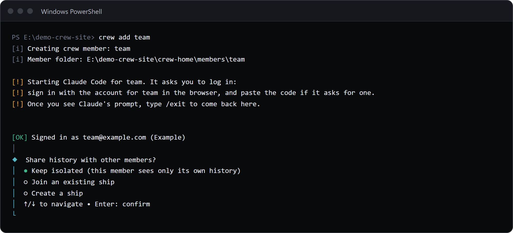

A crew member is one Claude login in its own folder.
Add one with `crew add <member>` in a terminal, switch the current one with `crew use <member>`, sign one in again with `crew login <member>`, and drop one with `crew drop <member>`.
Names use lowercase letters, digits and hyphens, start with a letter, and are at most 32 characters.

## Add a member

```sh
crew add side
```

1. crew makes the folder `~/.crewrota/members/side` (`%USERPROFILE%\.crewrota\members\side` on Windows), with mode 0700 (only you can open it) on macOS and Linux.
2. It starts Claude Code in that folder. Claude Code asks you to log in: sign in in the browser, paste the code if it asks for one, then type `/exit` once you see Claude's prompt.
3. It asks Claude Code whether the member is logged in, in that folder (`claude auth status`).
4. It prints `[OK] Signed in as <email> (<organisation>)`, or `(personal)` when the account has no organisation.
5. It asks "Share history with other members?": **Keep isolated** (the default), **Join an existing ship** (shown when you have one) or **Create a ship**.
6. It prints `Crew member side is ready ...` and `Start it with: crew run side`.



The first member you add becomes the current member; later ones do not.
Your main `~/.claude` login is never touched.

### Options

| Option | What it does |
|---|---|
| `--ship <ship>` | Join that ship instead of asking. If the ship does not exist, crew asks `Ship <ship> doesn't exist. Create it? (Y/n)` |
| `--sso` | Sign in with single sign-on, through `claude auth login --sso` |
| `--email <address>` | Pass that email to Claude Code's login, through `claude auth login --email <address>` |

Without `--sso` or `--email`, crew starts plain `claude` and lets its first screen ask for the login; a pasted code works there.

### When adding fails

- **No terminal.** `crewrota: Adding a crew member needs a terminal. It runs Claude Code's own login.` Run it in a terminal yourself; an agent or script cannot finish a browser login.
- **The name is taken.** `crewrota: Crew member main already exists`
- **A folder with that name is in the way.** `<folder> already exists but is not a crew member. Move it away, or pick another name.`
- **The login did not take.** If Claude Code reports the member is not logged in, or reports a different config folder, crew removes the folder it just made and stops with `... Removed <folder>; no crew member was created.` Nothing is left behind; run `crew add` again.
- **You cancel the ship question.** crew removes the new folder and prints `Nothing created.`

### Two members on one account

If the new login has the same email and organisation as an existing member, crew still adds it but warns:

```text
[!] Crew member main is already signed in as main@example.com (personal).
```

If that was a mistake, sign one of them in to another account with `crew login <member>`.

## See who is who

```sh
crew list
```

```text
*  main  home      5h 30%  7d 55%  (just now)  main@example.com (personal)
   side  home      5h 30%  7d 55%  (just now)  side@example.com (personal)
   team  isolated  5h 30%  7d 55%  (just now)  team@example.com (Example)
```

`*` marks the current member.
Each line shows the ship (or `isolated`), the last usage reading and its age, and the login, or `no login found`.
`crew ls` is the same command.

```sh
crew whoami
```

```text
Crew member:  main
Folder:       E:\demo-crew-pages1\crew-home\members\main
Ship:         home
Email:        main@example.com
Organisation: personal
Logged in:    yes
```

`crew whoami` asks Claude Code whether the current member is logged in.
`crew current` prints only the current member's name, and exits with code 1 when there is none.

## Switch the current member

```sh
crew use side
```

```text
Now using side.
```

The current member is the one `crew run` starts when you name none.
`crew use -` goes back to the previous one; with none it stops with `There is no previous crew member to go back to.`
If the member does not exist, `crew use` offers to create it (`Crew member <member> doesn't exist. Create it? (Y/n)`), which needs a terminal; without one it says `Run crew add <member> in a terminal.`

## Start a member

```sh
crew run side
crew side
```

Both start Claude Code as `side` with its saved ship, model and effort.
`crew run` with no name uses `$CREW_MEMBER`, else the current member.
Claude Code's own flags go after `--`, such as `crew side -- --resume <id>`; without the `--` crew stops with `Unknown option`.
See [What happens when a member launches](../concepts/launch.md).

## Sign a member in again

```sh
crew login side
```

```text
[!] Claude Code opens for side. Log in there, then type /exit to come back.
```

It starts Claude Code in the member's folder, the same way `crew add` does, and makes the folder again if it is missing.
`crew login side --sso` and `crew login side --email side@example.com` go through `claude auth login` with that option.
Use it after `crew restore`, after a logout, or when `crew doctor --logins` says a member is not logged in.

`crew logout side` runs `claude auth logout` for that member. The folder stays.

## Rename a member

```sh
crew rename side spare
```

```text
Renamed crew member side to spare.
```

The folder, the settings and the current or previous mark move to the new name, and any VS Code shortcut that ran `crew side` now runs `crew spare` (crew prints `Shortcuts now running crew spare: ...`).
crew refuses a name another member has (`Crew member spare already exists`) or a folder already in the way.
On Windows, a member with a running Claude session cannot be moved: `Windows refused to move <folder> because a file in it is in use, probably by a running Claude session. Close it and try again.`

## Drop a member

```sh
crew drop team --yes
```

```text
Folder: E:\demo-crew-inventory\crew-home\members\team
Ship: isolated
Session files in its projects folder: 0
Dropped crew member team. Its folder is kept at E:\demo-crew-inventory\crew-home\removed\team-20261104-1826
```

crew removes every link inside the member folder, then moves the folder to `removed/<member>-<date>-<time>` in your crew home.
Nothing is deleted: delete that folder yourself once you are sure.
The member's VS Code shortcuts are removed with it.
`crew remove` is the same command.

- Without `--yes`, crew asks `Drop crew member team? Its folder is moved to ...` (default no), which needs a terminal. Without one: `Confirming the drop needs a terminal. Pass --yes to drop without asking.`
- The current member is refused: `main is the current crew member. Switch first with crew use <member>, or pass --force.`
- A member on a ship leaves the ship's history in the ship.

## Related

- [Crew member commands, in full](../reference/members.md)
- [Share history between members with a ship](ships.md)
- [Members, ships and your main setup](../concepts/members-and-ships.md)
- [Your accounts and Anthropic's terms](../concepts/accounts-and-terms.md)
