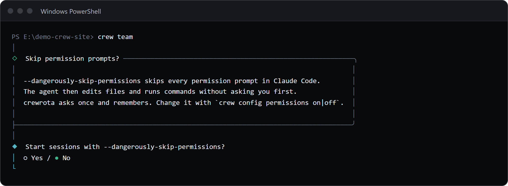

`--dangerously-skip-permissions` is a Claude Code flag that lets the agent edit files and run commands without asking you first.
crewrota asks once, at your first launch, whether every session should start with it; the default is no.
Change the answer any time with `crew config permissions on` or `crew config permissions off`.

## The one-time question

The first time you start any member, from the menu or with `crew <member>`, crew shows:



The note under "Skip permission prompts?" says that the flag skips every permission prompt in Claude Code, that the agent then edits files and runs commands without asking you first, and that crewrota asks once, remembers, and lets you change it with `crew config permissions on|off`.
crew then asks `Start sessions with --dangerously-skip-permissions?`, with No selected.
The answer is saved once Claude starts, and applies to every member.
If you cancel the question, crew prints `Nothing launched.` and asks again next time.

## Change the answer

```sh
crew config permissions on
```

```text
--dangerously-skip-permissions is on for every launch.
```

```sh
crew config permissions off
```

```text
--dangerously-skip-permissions is off for every launch.
```

`crew config show` and `crew doctor` show the current answer: `on`, `off` or `not asked yet`.

## Starting a member without a terminal

The question needs a terminal.
If it has not been answered, a launch without one (from a script or an agent) stops instead of guessing:

```sh
crew run main -- -p hi
```

```text
crewrota asks once whether to use --dangerously-skip-permissions, and that needs a terminal.
Answer it now with: crew config permissions on   (or off)
```

The exit code is 1.
Run `crew config permissions on` or `off` once, and headless launches work from then on.

## What the answer does

With it on, crew adds `--dangerously-skip-permissions` to every `claude` it starts, after the model and effort and before anything you pass after `--`.
With it off, crew adds nothing, and Claude Code asks for permission as usual.
crewrota never passes it to `crew warmup`, which runs Claude Code only to read usage.

Turn it on only for work you would let the agent do unwatched.
Running members headless, for example through `/firstmate`, with it on means those sessions act without asking.

## Related

- [Config commands, in full](../reference/config.md)
- [What happens when a member launches](../concepts/launch.md)
- [Guide for AI agents](../agents/index.md)
