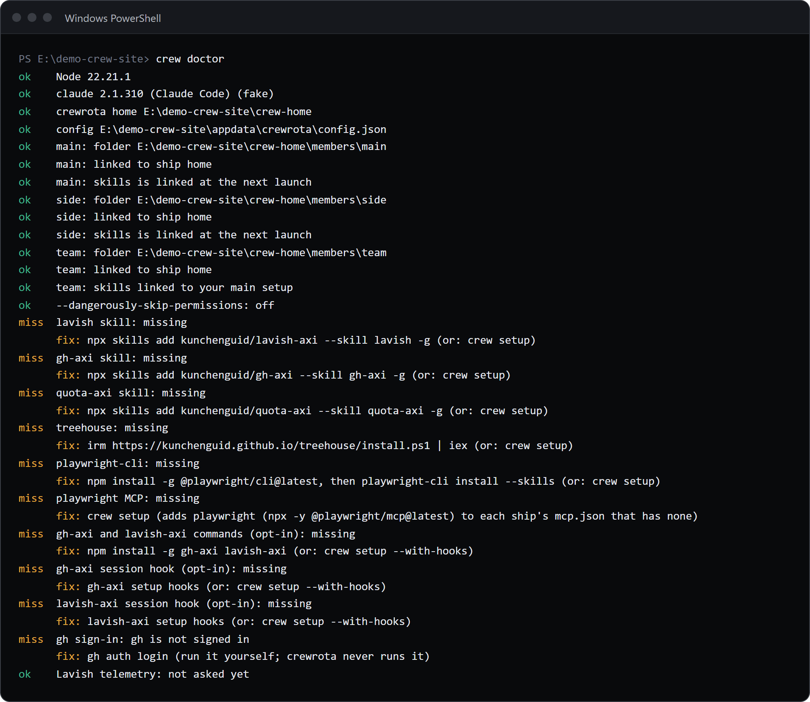

Run `crew doctor`.
It checks Node, Claude Code, your crew home and settings, every member's folder and links, and the default tools, and prints a `fix:` line under anything wrong.
`crew doctor --logins` also asks Claude Code whether each member is logged in.

## Read the doctor's lines

This demo crew has a member whose folder is gone:

```sh
crew doctor
```

```text
ok    Node 22.21.1
ok    claude 2.1.310 (Claude Code) (fake)
ok    crewrota home E:\demo-crew-pages1\crew-home
ok    config E:\demo-crew-pages1\appdata\crewrota\config.json
ok    main: folder E:\demo-crew-pages1\crew-home\members\main
ok    main: linked to ship home
ok    side: folder E:\demo-crew-pages1\crew-home\members\side
ok    side: linked to ship home
FAIL  team: folder E:\demo-crew-pages1\crew-home\members\team is missing
      fix: Log it in again with: crew login team (or drop it with: crew drop team)
ok    --dangerously-skip-permissions: off
miss  lavish skill: missing
      fix: npx skills add kunchenguid/lavish-axi --skill lavish -g (or: crew setup)
miss  gh-axi skill: missing
      fix: npx skills add kunchenguid/gh-axi --skill gh-axi -g (or: crew setup)
miss  quota-axi skill: missing
      fix: npx skills add kunchenguid/quota-axi --skill quota-axi -g (or: crew setup)
miss  treehouse: missing
      fix: irm https://kunchenguid.github.io/treehouse/install.ps1 | iex (or: crew setup)
miss  playwright-cli: missing
      fix: npm install -g @playwright/cli@latest, then playwright-cli install --skills (or: crew setup)
miss  playwright MCP: missing
      fix: crew setup (adds playwright (npx -y @playwright/mcp@latest) to each ship's mcp.json that has none)
miss  gh-axi and lavish-axi commands (opt-in): missing
      fix: npm install -g gh-axi lavish-axi (or: crew setup --with-hooks)
miss  gh-axi session hook (opt-in): missing
      fix: gh-axi setup hooks (or: crew setup --with-hooks)
miss  lavish-axi session hook (opt-in): missing
      fix: lavish-axi setup hooks (or: crew setup --with-hooks)
miss  gh sign-in: gh is not signed in
      fix: gh auth login (run it yourself; crewrota never runs it)
ok    Lavish telemetry: not asked yet
```

The `(fake)` comes from the stand-in for Claude Code the demo uses.

| Mark | Meaning |
|---|---|
| `ok` | Fine |
| `miss` | An optional tool is missing, or gh is not signed in. Never fails the doctor |
| `FAIL` | Something crewrota needs is wrong; the `fix:` line says what to do |

`crew doctor` exits with code 1 when any `FAIL` line is printed, and 0 otherwise.
In a terminal `ok` is green, `miss` amber and `FAIL` red.



## What each check means

| Check | When it fails | Fix |
|---|---|---|
| `Node` | Below Node 22 | Install Node.js 22 or newer from https://nodejs.org, then open a new terminal |
| `claude` | `claude was not found` | The Claude Code install command for your platform (below) |
| `crewrota home` | The crew home cannot be read | Check the folder's permissions |
| `config` | `config.json` is not valid JSON | Fix the JSON, or rename the file so crewrota starts a fresh one |
| `<member>: folder` | The member folder is missing | `crew login <member>`, or `crew drop <member>` |
| `<member>: linked to ship` | The link to the ship is missing, is a folder, or points elsewhere | `crew run <member>`: crewrota repairs links before every launch |
| `<member>: skills`, `agents`, `commands` | A link to your main setup is broken | `crew run <member>`; for "is a folder, not a link", move that folder away first |
| `<member>: logged in` (with `--logins`) | Claude Code says the member is not logged in | `crew login <member>` |
| `VS Code` (only once you have a shortcut) | VS Code was not found | Install VS Code; on a Mac, also add `code` to PATH |

The fix for a missing `claude`, as `crew doctor` prints it on each platform:

| Platform | Fix |
|---|---|
| Windows | `irm https://claude.ai/install.ps1 \| iex` (or `winget install Anthropic.ClaudeCode`), then open a new terminal |
| macOS | `curl -fsSL https://claude.ai/install.sh \| bash` (or `brew install --cask claude-code`), then open a new Terminal window |
| Linux | `curl -fsSL https://claude.ai/install.sh \| bash`, then open a new shell |

On Windows, the doctor also finds a `claude` installed through npm, which is a `.cmd` file only `cmd.exe` can start.

## Commands that need a terminal

These ask a question, so they stop with exit code 1 when there is no terminal (both input and output must be a terminal):

| Command | Message without a terminal | Headless instead |
|---|---|---|
| `crew` (the menu) | `The menu needs a terminal. Without one, use: crew run <member>` | `crew run <member>` |
| `crew add <member>` | `Adding a crew member needs a terminal. It runs Claude Code's own login.` | none: a person signs in |
| `crew use <missing member>` | `Crew member <m> doesn't exist. Creating it needs a terminal. Run crew add <m> in a terminal.` | `crew add` in a terminal |
| `crew ship join` to a missing ship | `Ship <s> doesn't exist. Creating it needs a terminal. Make it first with: crew ship create <s>` | `crew ship create <s>` first |
| `crew drop` without `--yes` | `Confirming the drop needs a terminal. Pass --yes to drop without asking.` | `--yes` |
| `crew ship delete` without `--yes` | `Confirming the deletion needs a terminal. Pass --yes to delete without asking.` | `--yes` |
| `crew setup` with something to install | `crew setup asks once before it installs anything, and that needs a terminal. Run it in a terminal, or pass --yes to install without asking.` | `--yes` |
| `crew backup` or `crew restore` with `--password` | `--password needs a terminal, or the password in CREWROTA_BACKUP_PASSWORD.` | set `CREWROTA_BACKUP_PASSWORD` |
| The first launch, before the permissions answer | `crewrota asks once whether to use --dangerously-skip-permissions, and that needs a terminal.` | `crew config permissions on` or `off` |

`crew login` does not check, but it hands the terminal to Claude Code's login, so run it yourself.

## Common errors

Most errors print as `crewrota: <message>` on stderr and exit with code 1.

| Message | What to do |
|---|---|
| `Unknown option: --resume` (or another Claude flag) | Put Claude's flags after `--`: `crew main -- --resume <id>` |
| `Unknown command: <args>` | crew prints the help; check the command name, or add the member first |
| `No crew member chosen. Pick one with: crew use <member>` | Name a member, or set a current one |
| `Crew member <m> doesn't exist. Create it with: crew add <m>` | Check `crew list`, or add it |
| `The folder of crew member <m> is missing: <folder>. Log it in again with: crew login <m>` | `crew login <m>` makes the folder and signs it in |
| `"<name>" is not a valid ship name. A ship name uses lowercase letters, digits and hyphens, starts with a letter, and is at most 32 characters.` | Pick a name that fits the rule; members and shortcuts use the same rule |
| `Windows refused to move <folder> because a file in it is in use, probably by a running Claude session. Close it and try again.` | Close every Claude session of that member (or on that ship) and run the command again |
| `<file> is not valid JSON (...). Nothing launched.` | Fix that file: a ship's `mcp.json`, or your main `~/.claude.json` or a member's `.claude.json` |
| `<link> is in the way of the link to <source>. Move it somewhere else and launch again. Nothing launched.` | Move that folder out of the member folder |
| `<file> is a link, and crewrota only writes a member's own files. Remove the link and launch again.` | Remove that link from the member folder |
| `crewrota needs bsdtar to write and read a backup zip (on Linux, install libarchive-tools).` | Install `libarchive-tools`, or set `CREWROTA_TAR` |
| `The widget needs Python 3 with Tk (the python.org installer includes both). Install it, then try again.` | Install Python 3 with Tk, or set `CREWROTA_PYTHON` |
| `VS Code was not found. Install it from https://code.visualstudio.com, then try again.` | Install VS Code, or set `CREWROTA_CODE` |

## Exit codes

- `0` when a command succeeds, `1` when it fails.
- `crew run` and `crew <member>` return Claude Code's own exit code.
- `crew current` exits with 1, and prints nothing, when there is no current member.
- `crew doctor` exits with 1 only when a `FAIL` line is printed.
- `crew widget close` exits with 1 when the widget is still open after 5 seconds.

See [Exit codes](../reference/exit-codes.md) for the full list.

## Still stuck

Report it as a GitHub issue at https://github.com/pasindu-premachandra/crewrota/issues, with the output of `crew --version` and `crew doctor`.
Check the doctor output for folder paths you would rather not share before you paste it.

## Related

- [crew setup, init and doctor, in full](../reference/setup-init-doctor.md)
- [Exit codes and terminal needs](../reference/exit-codes.md)
- [Use your main setup in every member](main-setup.md)
