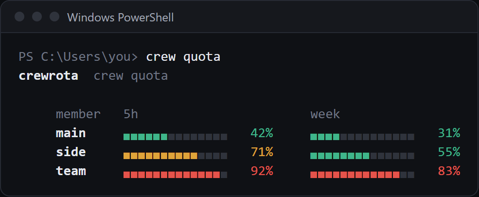

`crew quota` shows every member's 5-hour and week use as bars, and the crew menu shows the same bars above its members.
Both read usage with quota-axi first, one call per member side by side, and send no message.
`crew warmup` is the only command that sends a message: one short Haiku message per member, which starts its 5-hour window if none is running.

## Read the bars

```sh
crew quota
```

```text
crewrota  crew quota

     member   5h                       week
     main     ▖▖▖▖▖▖▖▖▖▖▖▖▖▖   30%     ▖▖▖▖▖▖▖▖▖▖▖▖▖▖   55%
     side     ▖▖▖▖▖▖▖▖▖▖▖▖▖▖   30%     ▖▖▖▖▖▖▖▖▖▖▖▖▖▖   55%
     team     ▖▖▖▖▖▖▖▖▖▖▖▖▖▖   30%     ▖▖▖▖▖▖▖▖▖▖▖▖▖▖   55%
```



- Each bar has 14 cells. It is green under 60%, amber from 60% and red from 80%.
- A window whose reset time has passed since the reading shows 0%.
- `-` means that window has no reading; `no reading yet` means the member has none at all.
- The colour is only there in a terminal. Piped into a file or another program, the bars are plain, so only the `N%` columns mean anything; the text block above is such a copy.

`crew list` shows the same readings in short form, with their age, and never checks usage first:

```text
*  main  home      5h 30%  7d 55%  (just now)  main@example.com (personal)
```

## When readings are taken

| What | Sends a message | Writes the reading |
|---|---|---|
| The crew menu opening | No | yes, for every member, through quota-axi, unless `crew config refresh off` |
| `crew quota` | No | yes, for every member, through quota-axi, unless `crew config refresh off` |
| A running Claude session, through crewrota's status line | No | yes, for that member |
| `crew warmup` | Yes, one short Haiku message per member | yes, for each member it warms up |
| `crew list`, `crew quota --format menubar`, the widget | No | no, they only read |

Each reading is saved to `quota.json` in the member's folder.
A member whose check fails keeps its last reading.
See [Where usage readings come from](../concepts/usage-readings.md).

## Turn the check off

While the menu checks usage, a terminal shows `Checking usage for <members> (crewrota reads each member's usage; stop it with: crew config refresh off)...` until the readings are in.

```sh
crew config refresh off
```

```text
The menu shows each member's last reading.
```

With it off, the menu and `crew quota` show each member's last reading without asking quota-axi.
`crew config refresh on` turns it back on (the default).

## Start an idle member's window

`crew warmup` sends each member one short message, which starts its 5-hour window if none is running, so the window is already counting when you need that member:

```sh
crew warmup team
```

```text
[i] Each member gets one short message (Haiku), which starts its 5-hour window if none is running.
crewrota  crew quota

     member   5h                       week
     main     ▖▖▖▖▖▖▖▖▖▖▖▖▖▖   30%     ▖▖▖▖▖▖▖▖▖▖▖▖▖▖   55%
     side     ▖▖▖▖▖▖▖▖▖▖▖▖▖▖   30%     ▖▖▖▖▖▖▖▖▖▖▖▖▖▖   55%
     team     ▖▖▖▖▖▖▖▖▖▖▖▖▖▖   12%     ▖▖▖▖▖▖▖▖▖▖▖▖▖▖   48%
```

With no names it warms up every member.
Each message runs in a temporary folder with no session saved, none of the member's settings, hooks or MCP servers, and stops as soon as Claude Code reports usage (or after 30 seconds).
The message counts against that member's usage, so run it only when you mean to.
The widget's bolt button runs the same command.

## Read the bars elsewhere

- On your desktop: [Keep usage on your desktop with the widget](widget.md).
- In the macOS menu bar (beta): [Show usage in the macOS menu bar](macos-menu-bar.md).
- Inside a Claude session: the status line crewrota gives a member without one shows `5h:N%` and `7d:N%`. See [Use your main setup in every member](main-setup.md#the-status-line).

## For scripts

`crew quota` and `crew list` print text for people; there is no `--json`.
A script can read each member's `quota.json` directly:

```text
{"ts":1793796958,"seen":1793796958,"five_hour_pct":30,"seven_day_pct":55,"five_hour_resets_at":2000000000,"seven_day_resets_at":2000604800}
```

`ts` is when the reading was saved, the `_pct` fields are percentages used, and the `_resets_at` fields are Unix times in seconds; any of them can be an empty string when unknown.
See [Files and folders](../reference/files-and-folders.md).

## Related

- [Usage commands, in full](../reference/usage.md)
- [Where usage readings come from](../concepts/usage-readings.md)
