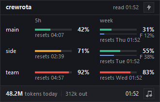

`crew widget` opens a small always-on-top window with every member's 5-hour and week bars.
`crew widget close` closes it, and on Windows `crew widget startup on` opens it at every login.
It needs Python 3 with Tk; the python.org installer includes both.



## Open it

```sh
crew widget
```

```text
[OK] The widget is open. Its bolt warms up every member; right-click it to refresh or quit; close it with: crew widget close
```

If it is already open: `[i] The widget is already open. Close it with: crew widget close`

The widget runs on its own, so you can close the terminal.
Drag it anywhere; it remembers its place.

## What it shows

- **One row per member**, with its 5-hour and week bars, each with a percentage and its reset time. The colours match `crew quota`: green under 60%, amber from 60%, red from 80%.
- **A thin blue Fable bar** under the week bar, with `F N%` beside it, for a member whose plan reports a weekly Fable figure. A member without one draws as before.
- **The age of the readings** in the title row, as `read HH:MM` for the newest reading, or `no readings yet`.
- **Dimmed rows** for a member whose last reading is more than 6 hours old.
- **Today's tokens** across the crew in the footer, summed from every member's session transcripts, with the output tokens beside them.
- **The clock**, a **music** button that opens a coding-music stream on YouTube, and a **bolt** button.

It only reads: the bars come from each member's `quota.json`, the same file `crew quota` and `crew list` read.
It redraws every 30 seconds, and at once when a newer reading lands.

## Warm up every member

The bolt button, or **Warm up all** in the right-click menu, runs `crew warmup`.
That sends each member one short Haiku message, which starts its 5-hour window if none is running; it is the only crewrota command that sends a message.
The title row shows `warming up...` until it is done.

## Right-click menu

| Item | What it does |
|---|---|
| Warm up all | Runs `crew warmup` for every member |
| Refresh | Redraws from the latest readings |
| Quit | Closes the widget |

## Close it

```sh
crew widget close
```

| Result | Output | Exit code |
|---|---|---|
| Closed | `[OK] Closed the widget.` | 0 |
| Not open | `[i] The widget is not open.` | 0 |
| Still open after 5 seconds | `[!] The widget did not close within 5 seconds. Right-click it and pick Quit.` | 1 |

## Open it at login (Windows)

```powershell
crew widget startup on
crew widget startup off
```

```text
[OK] The widget no longer opens at login.
```

`on` adds `crewrota widget.lnk` to your Startup folder (`%APPDATA%\Microsoft\Windows\Start Menu\Programs\Startup`); `off` removes it.
On macOS and Linux it stops with `Opening the widget at login is Windows-only for now; macOS gets a menu bar item later.`
On macOS, use the [menu bar plugin](macos-menu-bar.md) instead.

## Python

| Platform | crewrota looks for |
|---|---|
| Windows | `pythonw`, then `pyw`, so no console window opens |
| macOS and Linux | `python3` |

Set `CREWROTA_PYTHON` to the full path of another Python to use that one.
With none found: `The widget needs Python 3 with Tk (the python.org installer includes both). Install it, then try again.`
crewrota checks only that Python is there: if Python has no Tk, the command still reports the widget open, but no window appears.
Check that your Python can `import tkinter`.

> **Beta:** on macOS and Linux crewrota starts the widget with `python3` the same way, but it has not yet been tested there by hand.

## Files it uses

All in your crew home (`~/.crewrota` by default):

| File | What it holds |
|---|---|
| `widget.pid` | The widget's process id while it is open |
| `widget.json` | Its saved position |
| `widget.close` | Written by `crew widget close` to ask it to quit |

## Related

- [Check every member's usage](usage-and-quota.md)
- [Usage commands, in full](../reference/usage.md)
- [Show usage in the macOS menu bar](macos-menu-bar.md)
