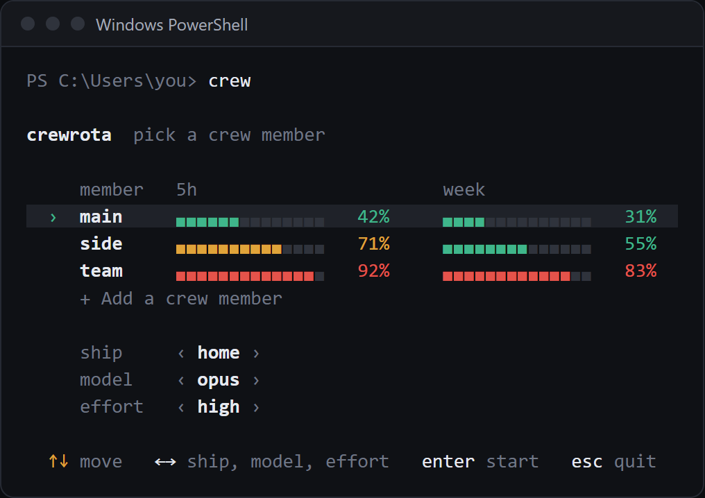

crewrota is a command line tool that runs Claude Code as one of your crew members.
A crew member is one Claude login in its own folder; a ship lets several members share history, so `--resume` finds a session another member started.
Install it with `npm install -g crewrota`, add a member with `crew add <member>`, and type `crew` to pick a member and start Claude.

## Who it is for

crewrota is for one person running their own Claude subscriptions.
If you keep separate logins, such as one for work and one for your own projects, you can keep each one signed in, carry your sessions across them, and see each one's usage, without signing out and in again.
Your main `~/.claude` login is never touched: each member has its own folder under `~/.crewrota/members/`.

## What it does

- **One screen to start.** `crew` shows every member with its 5-hour and week bars; pick one, its ship, model and effort, and Claude Code opens as that login.
- **Usage at a glance.** `crew quota` in the terminal, `crew widget` on your desktop, a menu bar item on macOS (beta).
- **Shared history.** Members on the same ship share history, memory and MCP servers.
- **Your setup in every member.** Your skills, agents, commands, plugins, settings and `CLAUDE.md` come with every member.
- **Backup and restore.** One zip moves your ships, settings, skills and project `.claude` folders to a new machine. Logins are never in it.
- **firstmate.** A Claude Code plugin that hands a task to other members running headless.

## Your logins

crewrota never copies or moves a login; to read usage, quota-axi uses each member's own sign-in on your machine.
Each member signs in through Claude Code's own login, and that login stays in the member's folder.
Read [Your accounts and Anthropic's terms](concepts/accounts-and-terms.md) before you use several accounts.

## Where to start

### Get started

- [Why crewrota, and what it is not](why.md)
- [Install crewrota](install.md)
- [Your first crew in five minutes](first-crew.md)
- Quickstarts: [Windows](windows/quickstart.md), [macOS (beta)](macos/quickstart.md), [Linux (beta)](linux/quickstart.md)
- [Platforms and versions](platforms.md)

### Guides

- [Add and manage crew members](guides/members.md)
- [Share history between members with a ship](guides/ships.md)
- [Give a ship's members the same MCP servers](guides/mcp-servers.md)
- [Check every member's usage](guides/usage-and-quota.md)
- [Keep usage on your desktop with the widget](guides/widget.md)
- [Show usage in the macOS menu bar](guides/macos-menu-bar.md)
- [Open a folder as a member from VS Code](guides/vscode-shortcuts.md)
- [Move your crew to a new machine](guides/backup-and-restore.md)
- [Use your main setup in every member](guides/main-setup.md)
- [Choose whether Claude asks for permission](guides/permissions.md)
- [Fix a problem with crew doctor](guides/troubleshooting.md)

### Concepts

- [Members, ships and your main setup](concepts/members-and-ships.md)
- [What happens when a member launches](concepts/launch.md)
- [Where usage readings come from](concepts/usage-readings.md)

### Reference and agents

- [Every command](commands.md)
- [Guide for AI agents](agents/index.md)
- [Architecture, for contributors](developers/architecture.md)
