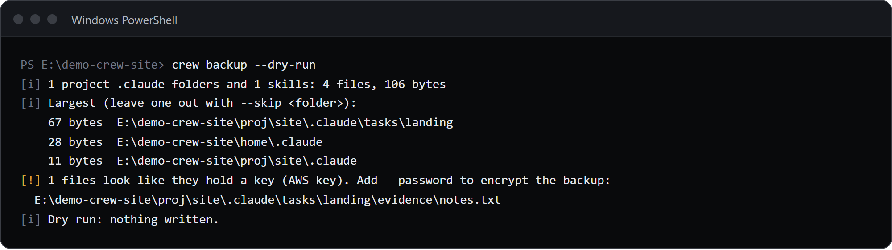
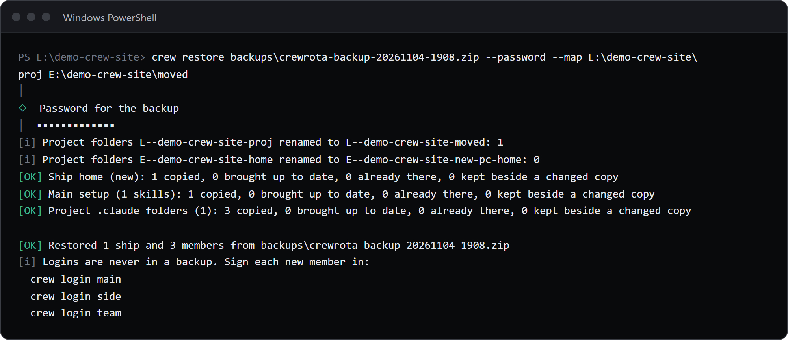

`crew backup` writes one zip with every ship, the member list, the settings, your project `.claude` folders and your main skills, and never a login.
`crew restore <zip>` merges it into this machine: ships merged, missing members made again without a login, `.claude` folders and skills added, project folders renamed to this machine's paths.
Both run without a terminal; with `--password`, the password then comes from `CREWROTA_BACKUP_PASSWORD`.
A task-by-task walk-through is in [Move your crew to a new machine](../guides/backup-and-restore.md).

## crew backup

```sh
crew backup [--to <folder>] [--password] [--skip <folder>]... [--no-context] [--dry-run]
```

| Flag | Default | What it does |
|---|---|---|
| `--to <folder>` | the current folder | Where the zip is written; the folder is made if needed |
| `--password` | off | Encrypt the zip with AES-256. Asked twice, hidden, in a terminal; without one, read from `CREWROTA_BACKUP_PASSWORD` |
| `--skip <folder>` | none | Leave a project, or any folder inside a `.claude`, out; repeat it for more |
| `--no-context` | off | Write only the ships, the member list and the settings: no project `.claude` folders and no main skills |
| `--dry-run` | off | Print the report and write nothing; no password is asked |

The zip is `crewrota-backup-<yyyymmdd-hhmm>.zip`.

```text
$ crew backup --to E:/demo-crew-inventory/out

[OK] Backup written: E:\demo-crew-inventory\out\crewrota-backup-20261104-1827.zip
[i] 8.2 KB, 1 ship, 2 members
[i] 1 project .claude folders and 1 skills: 8 files, 1.1 KB
[i] Largest (leave one out with --skip <folder>):
      1.0 KB  E:\demo-crew-inventory\proj\site\.claude
    43 bytes  E:\demo-crew-inventory\home\.claude
    37 bytes  E:\demo-crew-inventory\proj\site\.claude\tasks\landing
[!] 1 files look like they hold a key (AWS key). Add --password to encrypt the backup:
  E:\demo-crew-inventory\proj\site\.claude\tasks\landing\evidence\notes.txt
[i] No login is in it: after a restore, each member signs in again with crew login <member>.

[exit code 0]
```



### What goes in

- `manifest.json`: the backup format (2), the crewrota version, the time, the platform, your home folder, the ships, each member with its ship, model and effort, and the context it found.
- `config.json`: your settings.
- `ships/<ship>/`: each ship's five folders and its `mcp.json`, keys included.
- `context/roots/r<N>/.claude`: each project `.claude` folder, and a `CLAUDE.md` beside it when git does not track it.
- `context/main/`: the skills, agents, commands and `CLAUDE.md` from `~/.claude`. A linked skill is stored as real files.

How the projects are found: crewrota reads the folders Claude Code worked in from the transcripts and `.claude.json` files, takes every `.claude` at or above them, and looks up to six levels below the top-most of them. Config folders and linked git worktrees are skipped.

### What stays out

- Never a member folder, so never a login.
- Files by name: `.credentials*`, `.env` and `.env.*` (but `.env.example`, `.env.sample` and `.env.template` go in), `.netrc`, `.htpasswd`, `.npmrc`, `id_rsa`, `id_dsa`, `id_ecdsa`, `id_ed25519` and their kin, and files ending in `.pem`, `.key`, `.p12`, `.pfx`, `.pkcs12`, `.ppk`, `.keystore`, `.jks`, `.ovpn`, `.kdb` or `.keychain`; `settings.local.json`; `*.lock`; earlier backup zips.
- Folders by name: `node_modules`, `.git`, `worktrees`, `.worktrees`, `__pycache__`, `.venv`, `venv`, `.next`, `.trash`.

### The report

| Line | Meaning |
|---|---|
| `[OK] Backup written: <file>` | The zip, then its size, ships, members and `encrypted` when it is |
| `[i] N project .claude folders and N skills: N files, <size>` | What the context holds |
| `[i] Largest (leave one out with --skip <folder>):` | The five largest folders |
| `[i] N login or key files stayed behind: ...` | Files left out by name |
| `[!] Could not read N, left out: ...` | Files it could not read |
| `[!] <repo>: N changed files, N unpushed commits. Only pushed code comes back on a new machine.` | A repo with work that is not pushed, or `no remote` |
| `[!] N files look like they hold a key (<kind>). Add --password to encrypt the backup:` | A best-effort check of copied files under 1 MB for private keys and AWS, GitHub, GitLab, Anthropic, OpenAI, Slack, Stripe live, npm and Google API keys; only file names are printed, never the value. Not shown with `--password` |
| `[!] The backup holds the MCP servers of <ships> with their keys in plain text. Add --password to encrypt it.` | A ship has MCP servers and there is no password |
| `[!] --skip <folder>: no such folder.` | A `--skip` that does not exist |
| `[i] Dry run: nothing written.` | `--dry-run` |
| `[i] No login is in it: ...` | Always last |

### Password

Every zip option goes to bsdtar in one `--options` string: `zip:hdrcharset=UTF-8,zip:encryption=aes256`.
File and folder names inside the zip stay readable even with a password; only the contents are encrypted.

```text
$ crew backup --password --to E:/demo-crew-inventory/out

crewrota: --password needs a terminal, or the password in CREWROTA_BACKUP_PASSWORD.

[exit code 1]
```

In a terminal, `Password for the backup` and `The same password again`; they must match (`The two passwords differ. Nothing written.`).

### Names outside plain ASCII

A file or folder name outside plain ASCII in the context (Sinhala, Tamil, Japanese, and so on) is stored as `~crew1`, `~crew2` and so on, because the tar in current Windows crashes on such names.
The manifest maps them back, and the restore puts the real names back.

### Other notes

- It needs bsdtar: on Windows `%SystemRoot%\System32\tar.exe`, never the `tar` on PATH; elsewhere `bsdtar`, or a `tar` whose `--version` says bsdtar. On Linux install `libarchive-tools`. `CREWROTA_TAR` names another. Without one: `crewrota needs bsdtar to write and read a backup zip (on Linux, install libarchive-tools).`
- It stages files in a `.crew-stage-*` folder beside the zip and removes it after.
- A zip of the same name fails: `<file> already exists. Wait a minute, or pick another folder with --to.`
- In a terminal, progress bars show the long steps on stderr; piped output and `CI=true` have none.
- `--dry-run --no-context` still gathers and reports the context; only a real backup leaves it out.

## crew restore

```sh
crew restore <zip> [--map <old>=<new>]... [--password] [--clone]
```

| Flag | Default | What it does |
|---|---|---|
| `--map <old>=<new>` | none | Put what was under `<old>` under `<new>` on this machine; repeat it for more. The longest match wins |
| `--password` | off | Open an encrypted zip. Asked once, hidden, in a terminal; without one, read from `CREWROTA_BACKUP_PASSWORD` |
| `--clone` | off | Clone each repo from its `origin` into its folder when the code is not there |

```text
$ crew restore E:/demo-crew-inventory/out2/crewrota-backup-20261104-1827.zip --password --map E:\demo-crew-inventory\proj=E:\demo-crew-inventory\moved

[i] Project folders E--demo-crew-inventory-proj renamed to E--demo-crew-inventory-moved: 1
[i] Project folders E--demo-crew-inventory-home renamed to E--demo-crew-inventory-home2: 0
[OK] Ship home (new): 2 copied, 0 brought up to date, 0 already there, 0 kept beside a changed copy
[OK] Main setup (1 skills): 1 copied, 0 brought up to date, 0 already there, 0 kept beside a changed copy
[OK] Project .claude folders (1): 7 copied, 0 brought up to date, 0 already there, 0 kept beside a changed copy

[OK] Restored 1 ship and 2 members from E:/demo-crew-inventory/out2/crewrota-backup-20261104-1827.zip
[i] Logins are never in a backup. Sign each new member in:
  crew login main
  crew login side

[exit code 0]
```



### What it does, in order

1. Unpacks the zip into `<crew home>/restore-<stamp>` and refuses a zip that holds a link, has no `manifest.json`, or has a format other than 1 or 2.
2. Renames the ships' project folders to this machine's paths. Claude Code names a project folder after its full path with every character other than an ASCII letter or digit made a hyphen, so `E:\Projects` is `E--Projects`. Your old home folder maps to this one on its own; `--map` adds more. A new name over 200 characters gets a warning, because Claude Code shortens such names with its own hash.
3. Merges each ship: new files copied, the same file skipped, a transcript that only grew brought up to date, a file changed on both sides kept beside yours as `<name>.incoming-<n><ext>`. MCP servers the local ship lacks are added.
4. Makes every member you do not have, with no login, on its ship. A member you already have is left alone.
5. Fills settings you have not set from the backup's `config.json`; your own settings stay.
6. Adds the skills, agents, commands and `CLAUDE.md` to your main `~/.claude`, never overwriting; a skill that is a link here is left alone.
7. Puts each project `.claude` back at its folder, mapped by `--map` and your home folder, and a `CLAUDE.md` that git did not track. With `--clone`, each repo is cloned first, into an empty folder or one holding only `.claude` and `CLAUDE.md`.
8. Lists the plugins you had as `claude plugin install <id>` lines.
9. Prints one `crew login <member>` line per member it made, then deletes the unpacked folder.

Run it again at any time: what is already there is skipped.

```text
$ crew restore E:/demo-crew-inventory/out/crewrota-backup-20261104-1827.zip --map E:\demo-crew-inventory\proj=E:\demo-crew-inventory\moved

[i] Project folders E--demo-crew-inventory-proj renamed to E--demo-crew-inventory-moved: 1
[i] Project folders E--demo-crew-inventory-home renamed to E--demo-crew-inventory-home2: 0
[OK] Ship home: 0 copied, 0 brought up to date, 2 already there, 0 kept beside a changed copy
[OK] Main setup (1 skills): 0 copied, 0 brought up to date, 1 already there, 0 kept beside a changed copy
[OK] Project .claude folders (1): 0 copied, 0 brought up to date, 7 already there, 0 kept beside a changed copy

[OK] Restored 1 ship and 0 members from E:/demo-crew-inventory/out/crewrota-backup-20261104-1827.zip
[i] Already here, left alone: main, side

[exit code 0]
```

### Messages

| Message | Meaning |
|---|---|
| `<zip> is not a file` | The path is wrong |
| `<zip> is encrypted. Add --password.` | An encrypted zip without `--password` |
| `The password does not open <zip>.` | Wrong password |
| `--map takes <old folder>=<new folder>.` | A `--map` without `=`, or with an empty side |
| `The backup holds a link (<entry>), so crewrota restored nothing from it.` | The zip holds a link |
| `<zip> is not a crewrota backup: it has no manifest.json.` | Not a crewrota zip |
| `<zip> has backup format <n>; this crewrota reads formats 1 and 2. Update crewrota and try again.` | A newer backup |
| `[i] Added to ship <ship>'s MCP servers: <names>` | Servers the local ship lacked |
| `[!] <folder> already exists but is not a crew member, so <member> was not re-created.` | A folder is in the way |
| `[i] Skill <name> is a link here, left alone.` | A linked skill in your main setup |
| `[i] Code not here yet: <folder> (<remote>). Add --clone to fetch it.` | A repo whose code is missing |
| `[OK] Cloned <remote> into <folder>` | With `--clone` |
| `[!] Could not clone <remote> into <folder>. Its .claude still comes back; run this again once you have access.` | The clone failed |
| `[!] <folder> already holds other files, so <remote> was not cloned.` | The folder is not empty |
| `[!] <folder> had no remote, so its code is not coming back.` | A repo without `origin` |
| `[!] N folders have no place on this machine. Run this again with --map <old>=<new>:` | A drive that does not exist here |
| `[i] Plugins are installed from their marketplaces, not from a backup. Those you had:` | Followed by `claude plugin install` lines |
| `[i] Already here, left alone: <members>` | Members you already had |

A `.claude` folder can hold hooks and settings that run on your machine, so restore only a backup you made yourself.

## Related

- [Move your crew to a new machine](../guides/backup-and-restore.md)
- [Files and folders](files-and-folders.md)
- [Environment variables](environment-variables.md)
