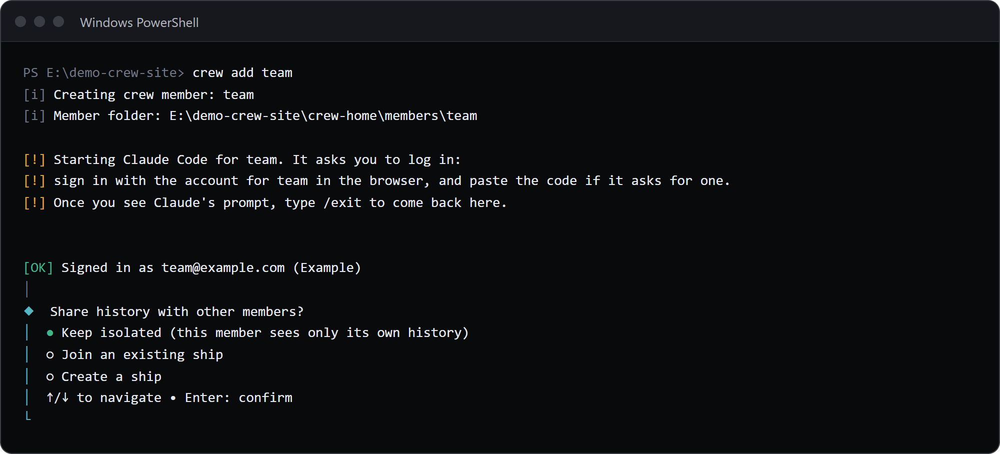

A member is one Claude login in its own folder, `<crew home>/members/<member>`.
`crew add` creates one through Claude Code's own login, `crew use` picks the current one, `crew list`, `crew whoami` and `crew current` show them, `crew login` and `crew logout` sign one in or out, `crew rename` renames one and `crew drop` moves one to `removed/`.
Only `crew add` always needs a terminal.

Names use lowercase letters, digits and hyphens, start with a letter, and are at most 32 characters.
A name that breaks the rule fails with `"<name>" is not a valid crew member name. A crew member name uses lowercase letters, digits and hyphens, starts with a letter, and is at most 32 characters.`

## crew add

Create a member and log it in.

```sh
crew add <member> [--ship <ship>] [--email <email>] [--sso]
```

| Flag | Default | What it does |
|---|---|---|
| `--ship <ship>` | none: you are asked | Put the new member on this ship; if the ship does not exist, it asks `Ship <ship> doesn't exist. Create it? (Y/n)` |
| `--email <email>` | none | Log in with `claude auth login --email <email>` instead of Claude Code's first screen |
| `--sso` | off | Log in with `claude auth login --sso` |

### What happens

1. It makes `<crew home>/members/<member>` (mode 0700 on macOS and Linux).
2. Without `--email` or `--sso` it starts plain `claude` in that folder, and Claude Code's first screen asks you to log in; a pasted code works there. With either flag it runs `claude auth login` with the flags.
3. It runs `claude auth status --json` with `CLAUDE_CONFIG_DIR` at the folder. The member must be logged in and Claude Code must report that same folder.
4. It prints `Signed in as <email> (<organisation or personal>)`, and warns when another member is signed in to the same email and organisation.
5. Without `--ship` it asks `Share history with other members?`: Keep isolated (the default), Join an existing ship (shown when you have one) or Create a ship.
6. It saves the member, makes it current when there is no current member, joins the ship, and prints how to start it.

Output, from a demo crew where the login signed in to the same account as `main`:

```text
[i] Creating crew member: spare
[i] Member folder: E:\demo-crew-pages1\crew-home\members\spare

[!] Starting Claude Code for spare. It asks you to log in:
[!] sign in with the account for spare in the browser, and paste the code if it asks for one.
[!] Once you see Claude's prompt, type /exit to come back here.


[OK] Signed in as main@example.com (personal)
[!] Crew member main is already signed in as main@example.com (personal).

[OK] Crew member spare is ready, isolated.
[i] Start it with: crew run spare
```



### Errors

| Message | When |
|---|---|
| `Crew member <member> already exists` | The name is taken |
| `Adding a crew member needs a terminal. It runs Claude Code's own login.` | No terminal (exit 1) |
| `<folder> already exists but is not a crew member. Move it away, or pick another name.` | A folder of that name is already in `members/` |
| `... Removed <folder>; no crew member was created.` | The login did not complete, or `claude auth status` reported a different config folder; the new folder is deleted |

Cancelling at any question leaves nothing behind and prints `Nothing created.`

## crew use

Make a member the current one, or go back to the previous one.

```sh
crew use <member>
crew use -
```

No flags.

```text
$ crew use side

Now using side.

[exit code 0]
```

```text
$ crew use -

Now using main.

[exit code 0]
```

- The old current member becomes the previous one.
- `crew use -` with no previous member fails with `There is no previous crew member to go back to.`
- A member that does not exist: in a terminal it asks `Crew member <member> doesn't exist. Create it? (Y/n)` and runs the `crew add` steps, then makes it current. Without a terminal it fails:

```text
$ crew use ghost

crewrota: Crew member ghost doesn't exist. Creating it needs a terminal. Run crew add ghost in a terminal.

[exit code 1]
```

## crew list

Every member on one line each.

```sh
crew list
crew ls
```

No flags or arguments; anything extra fails with `Usage: crew list`.

```text
$ crew list

*  main  isolated  5h 86%  7d 71%  (just now)  main@example.com (personal)
   side  isolated  5h 12%  7d 34%  (just now)  side@example.com (personal)
   team  isolated  5h 47%  7d 62%  (just now)  team@example.com (Example)

[exit code 0]
```

Each line: `*` on the current member, the name, its ship or `isolated`, its last usage reading with its age (or `no reading yet`), and the email with the organisation, `personal`, or `no login found`.
A reading with a weekly Fable figure adds it after the week, as `5h 30%  7d 55%  F 20%`.
It reads `quota.json` only and never checks usage.
With no members it prints `No crew members yet. Add one with: crew add <member>`.

## crew whoami

The current member in detail.

```sh
crew whoami
```

```text
$ crew whoami

Crew member:  main
Folder:       E:\demo-crew-pages1\crew-home\members\main
Ship:         home
Email:        main@example.com
Organisation: personal
Logged in:    yes

[exit code 0]
```

`Logged in` comes from `claude auth status --json` run in the member's folder.
With no current member it fails with `No current crew member. Pick one with: crew use <member>` (exit 1).

## crew current

The current member's name, and nothing else.

```sh
crew current
```

```text
$ crew current

main

[exit code 0]
```

With no current member it prints nothing and exits with 1, so a script can test it:

```sh
member=$(crew current) || echo "no current member"
```

## crew login

Log a member in again, in its own folder.

```sh
crew login <member> [--email <email>] [--sso]
```

| Flag | Default | What it does |
|---|---|---|
| `--email <email>` | none | Run `claude auth login --email <email>` |
| `--sso` | off | Run `claude auth login --sso` |

Without a flag it prints a line and starts plain `claude` in the member's folder; log in there, then type `/exit`:

```text
$ crew login side

[!] Claude Code opens for side. Log in there, then type /exit to come back.

[exit code 0]
```

- The member must exist. Its folder is made again if it is missing.
- crewrota does not check for a terminal, but the login is Claude Code's own and needs you at the keyboard.
- The exit code is Claude Code's.

## crew logout

Log a member out; its folder and history stay.

```sh
crew logout <member>
```

It runs `claude auth logout` with `CLAUDE_CONFIG_DIR` at the member's folder and exits with Claude Code's exit code.
A missing folder fails with `The folder of crew member <member> is missing: <folder>`.

## crew rename

Rename a member.

```sh
crew rename <old> <new>
```

```text
$ crew rename side spare

Renamed crew member side to spare.
Shortcuts now running crew spare: site

[exit code 0]
```

- It renames the folder and the entry in `config.json`, and moves the current and previous marks with it.
- Shortcuts for the member are rewritten to run `crew <new>`, and listed.
- It refuses a name that is taken (`Crew member <new> already exists`) or a folder of that name.
- On Windows a running Claude session can hold a file open: `Windows refused to move <folder> because a file in it is in use, probably by a running Claude session. Close it and try again. Nothing changed.`

## crew drop

Drop a member: its folder moves to `removed/`.

```sh
crew drop <member> [--force] [--yes]
crew remove <member> [--force] [--yes]
```

| Flag | Default | What it does |
|---|---|---|
| `--force` | off | Allow dropping the current member |
| `--yes` | off | Do not ask; needed without a terminal |

```text
$ crew drop team --yes

Folder: E:\demo-crew-inventory\crew-home\members\team
Ship: isolated
Session files in its projects folder: 0
Dropped crew member team. Its folder is kept at E:\demo-crew-inventory\crew-home\removed\team-20261104-1826

[exit code 0]
```

- It prints the folder, the ship, the number of session files when the member is isolated, and the shortcuts that go with it.
- Without `--yes` it asks `Drop crew member <member>? Its folder is moved to <crew home>/removed` (default No); without a terminal it fails with `Confirming the drop needs a terminal. Pass --yes to drop without asking.`
- The current member needs `--force`: `<member> is the current crew member. Switch first with crew use <member>, or pass --force.` Dropping it leaves no current member.
- It removes every link inside the folder first, then moves the folder to `removed/<member>-<yyyymmdd-hhmm>`. The ship's files and your main setup are not touched. Its shortcuts are deleted.

## Related

- [Add and manage crew members](../guides/members.md)
- [Menu and run](menu-and-run.md)
- [Exit codes and terminal needs](exit-codes.md)
