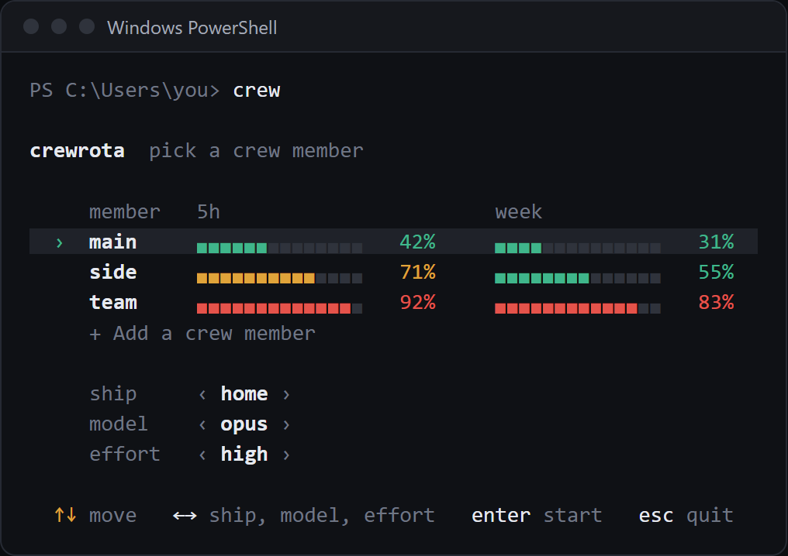
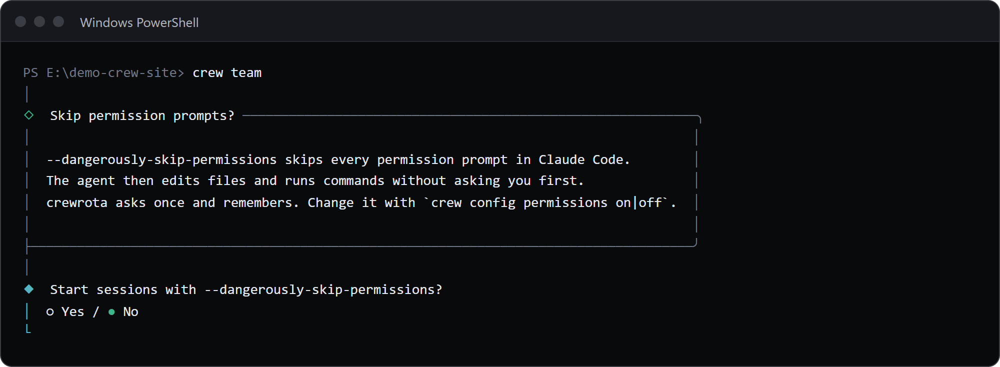

`crew` with no arguments opens the menu, where you pick a member, its ship, a model and an effort, then start Claude Code as that member.
`crew run <member>` and its short form `crew <member>` start a member without the menu, with its remembered model, effort and ship, and work without a terminal once the permissions question is answered.
Anything after `--` goes to Claude Code.

## crew (the menu)

Pick a member and its settings on one screen, then start Claude Code.

```sh
crew
```

No flags.
It needs a terminal; without one it prints `The menu needs a terminal. Without one, use: crew run <member>` and exits with 1.

### What the screen shows

With at least one member, the menu is one screen:

- a row per member, sorted by name, with its 5-hour and week bars;
- `+ Add a crew member` under the members;
- one settings line: `ship`, `model` and `effort`;
- a key line at the bottom.



The cursor starts on the current member.
Each bar has 14 cells: green under 60%, amber from 60% and red from 80%.
A window whose reset time has passed since the reading shows 0%.
A member with no reading shows `no reading yet`.

### Keys

| Key | What it does |
|---|---|
| Up and down | Move between members and `+ Add a crew member` |
| `1` to `9` | Jump to that member |
| Tab, Shift+Tab | Move between `ship`, `model` and `effort` |
| Left and right | Change the setting the cursor is on |
| Enter | Start, or add a member when `+ Add a crew member` is picked |
| Esc | Quit; prints `Nothing launched.` and exits with 0 |

Moving to another member loads that member's remembered ship, model and effort.

### Settings

| Setting | Values | Default |
|---|---|---|
| `ship` | `isolated`, then every ship by name | the member's ship, else `isolated` |
| `model` | `Claude's default`, `fable`, `opus`, `sonnet`, a model the member used before, `type a name` | the member's last model, else the last model used, else `Claude's default` |
| `effort` | `Claude's default`, `low`, `medium`, `high`, `xhigh`, `max` | the member's last effort, else the last effort used, else `Claude's default` |

`type a name` asks `Model name (an alias or a full model name)` after you press Enter.
`Claude's default` passes no `--model` or `--effort`, so Claude Code uses its own default.
Picking a ship other than the member's saved one joins that ship (or leaves it, for `isolated`) before Claude starts.

### Before the screen opens

Unless `crew config refresh off` is set, the menu first reads every member's usage with quota-axi, side by side, and prints `Checking usage for <who> (crewrota reads each member's usage; stop it with: crew config refresh off)...` until it is done.
No message is sent to any member.

### Step-by-step mode

With no members yet, the menu asks one question at a time: `No crew members yet`, then the new member's name, the login and the "Share history" question from [`crew add`](members.md#crew-add), then the model and the effort.
It does the same for screen readers: when the `ACCESSIBLE` environment variable is set to any value other than `0` or `false`, the menu skips the one-screen view and the usage check and asks `Crew member`, `Model` and `Effort` as separate questions.

### The first launch

The first time any member starts, crewrota shows a note headed "Skip permission prompts?" and asks once: `Start sessions with --dangerously-skip-permissions?`



The default is No.
The answer is saved only once Claude Code has started.
See [Choose whether Claude asks for permission](../guides/permissions.md).

### What it writes

On start it saves the member's model and effort, the last model and effort, and the permissions answer in `config.json`, and a ship change.

## crew run

Start Claude Code as a member, without the menu.

```sh
crew run [<member>] [-- <claude args>]
```

| Argument | Default | What it is |
|---|---|---|
| `<member>` | `$CREW_MEMBER`, else the current member | The member to start |
| `-- <claude args>` | none | Passed to Claude Code after crewrota's own flags |

`crew run` has no flags of its own.

### Which member starts

1. The `<member>` you name.
2. Else the `CREW_MEMBER` environment variable.
3. Else the current member (`crew use <member>` sets it).

With none of these, it fails:

```text
$ crew run

crewrota: No crew member chosen. Pick one with: crew use <member>

[exit code 1]
```

An unknown member:

```text
$ crew run ghost

crewrota: Crew member ghost doesn't exist. Create it with: crew add ghost

[exit code 1]
```

### The Claude command line

crewrota runs `claude` with this argument list:

```text
[--model <model>] [--effort <effort>] [--dangerously-skip-permissions] <claude args>
```

- `--model` and `--effort` come from the member's remembered choice, and are left out when it is `default`.
- `--dangerously-skip-permissions` is added when `crew config permissions on` is set.
- `CLAUDE_CONFIG_DIR` is set to the member's folder, and `LAVISH_AXI_TELEMETRY=0` is added when Lavish telemetry is off.
- Claude starts in the folder you ran `crew` from.

For example, with permissions on and the model and effort at their defaults, `crew main -- --resume abc` runs `claude --dangerously-skip-permissions --resume abc` with `CLAUDE_CONFIG_DIR` at main's folder.

### Before Claude starts

crewrota checks the member's folder, repairs its ship links, links and copies your main setup into it, copies the ship's MCP servers into its `.claude.json`, and gives it crewrota's status line if it has none.
Anything worth knowing prints as `[i]` lines on stdout before Claude starts.
The steps are in [What happens when a member launches](../concepts/launch.md).

A member whose folder is gone fails:

```text
crewrota: The folder of crew member team is missing: E:\demo-crew-pages1\crew-home\members\team. Log it in again with: crew login team
```

### Without a terminal

`crew run` works from a script or an agent once the permissions question has an answer.
Before that it prints these two lines to stderr and exits with 1:

```text
$ crew run main -- -p hi

crewrota asks once whether to use --dangerously-skip-permissions, and that needs a terminal.
Answer it now with: crew config permissions on   (or off)

[exit code 1]
```

A headless run, with Claude's JSON written to a file:

```sh
crew run main -- -p "Summarise README.md in one line" --output-format json > run.json
```

The `[i]` lines, when there are any, come before Claude's JSON in the same output.

### Exit code

`crew run` exits with Claude Code's own exit code.
Ctrl+C goes to Claude while it runs.
When Claude cannot be started at all, crewrota prints `crewrota: could not start claude: <reason>` and exits with 1.

## `crew <member>`

The short form of `crew run <member>`.

```sh
crew <member> [-- <claude args>]
```

It works when `<member>` is the name of a member; any other word is an unknown command, which prints `Unknown command: <word>` and the help, and exits with 1.
Everything else is `crew run`.

## The `--` rule

crewrota reads every argument before `--` as its own.
A Claude flag there is an unknown option:

```text
$ crew main --resume abc

crewrota: Unknown option: --resume
[exit code 1]
```

Put Claude's flags after `--`:

```sh
crew main -- --resume abc
crew run side -- -p "Reply with READY" --output-format json
```

A session started by one member can be resumed by another member on the same ship, because they share the `projects` folder.
See [Resume a session from another member](../guides/ships.md#resume-a-session-from-another-member).

## Related

- [Members reference](members.md)
- [Permissions](../guides/permissions.md)
- [Exit codes and terminal needs](exit-codes.md)
