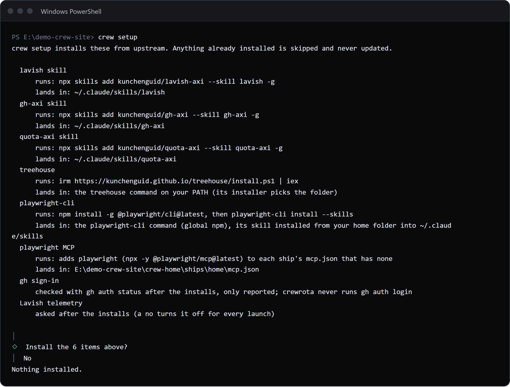
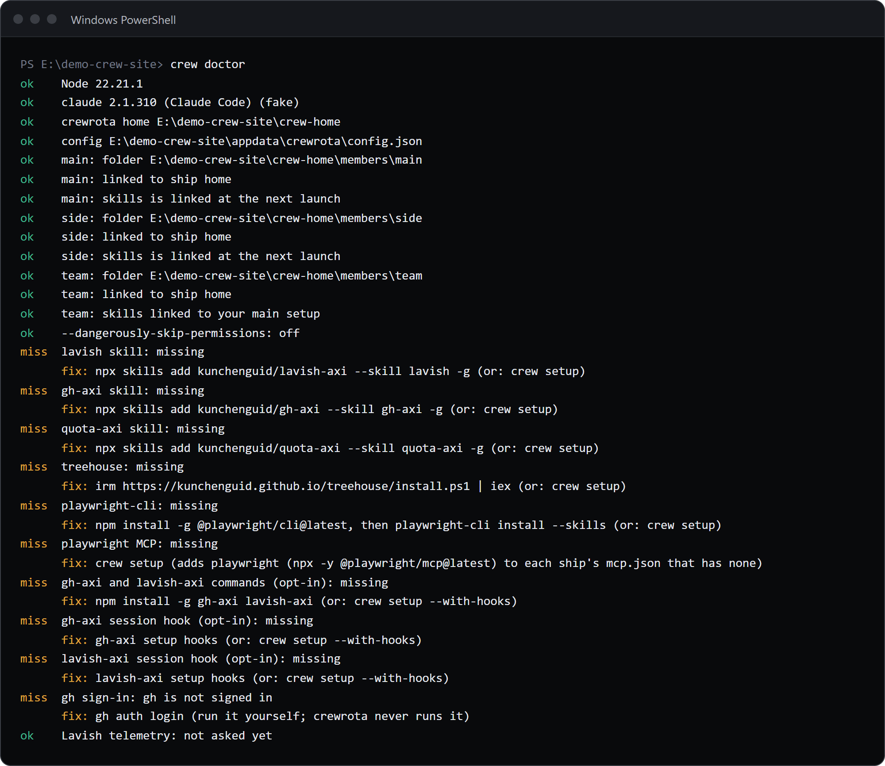

`crew setup` installs the default tools from upstream after one list and one yes, `crew init` writes a project's root `.claude/` folder for the `/firstmate` skill, and `crew doctor` checks Node, Claude Code, your crew's folders and links, and each default tool.
`crew init` and `crew doctor` never ask anything; `crew setup` needs a terminal unless you pass `--yes`.

## crew setup

```sh
crew setup [--yes] [--with-hooks]
```

| Flag | Default | What it does |
|---|---|---|
| `--yes` | off | Install without asking; also skips the Lavish telemetry question |
| `--with-hooks` | off | Also install the `gh-axi` and `lavish-axi` commands and their SessionStart hooks |

It prints every tool with the command it runs and where it lands, asks `Install the N items above?` (default yes), then installs what is missing.
Anything already installed is skipped and never updated.

### The tools

| Tool | Command | Lands in | Counted as installed when |
|---|---|---|---|
| lavish skill | `npx skills add kunchenguid/lavish-axi --skill lavish -g` | `~/.claude/skills/lavish` | that folder exists |
| gh-axi skill | `npx skills add kunchenguid/gh-axi --skill gh-axi -g` | `~/.claude/skills/gh-axi` | that folder exists |
| quota-axi skill | `npx skills add kunchenguid/quota-axi --skill quota-axi -g` | `~/.claude/skills/quota-axi` | that folder exists |
| treehouse | `irm https://kunchenguid.github.io/treehouse/install.ps1 \| iex` in PowerShell on Windows; `curl -fsSL https://kunchenguid.github.io/treehouse/install.sh \| sh` elsewhere | the `treehouse` command on your PATH | `treehouse` is on PATH |
| playwright-cli | `npm install -g @playwright/cli@latest`, then `playwright-cli install --skills` run from your home folder | the `playwright-cli` command and its skill in `~/.claude/skills` | `playwright-cli` is on PATH |
| playwright MCP | adds `playwright` (`npx -y @playwright/mcp@latest`) to each ship's `mcp.json` that has none | each such ship's `mcp.json` | every ship has it, or there are no ships |
| gh-axi and lavish-axi commands (`--with-hooks`) | `npm install -g gh-axi lavish-axi` | global npm packages | both are on PATH |
| gh-axi session hook (`--with-hooks`) | `gh-axi setup hooks` | a SessionStart hook in `~/.claude/settings.json` | the hooks in that file mention `gh-axi` |
| lavish-axi session hook (`--with-hooks`) | `lavish-axi setup hooks` | a SessionStart hook in `~/.claude/settings.json` | the hooks in that file mention `lavish-axi` |

Skills land in `~/.claude/skills`, which every member links.
The `--with-hooks` items are the only ones that write to `~/.claude/settings.json`, and they do it through the upstream tools' own commands.

### After the installs

- In a terminal and without `--yes`, it asks once: `Let lavish-axi send its usage telemetry? (No sets LAVISH_AXI_TELEMETRY=0 for every launch)`. The answer is saved as `lavishTelemetry`.
- It runs `gh auth status` and only reports it. It never runs `gh auth login`; sign in to GitHub yourself.
- A step that fails prints `[!] <tool>: <command> did not finish. Run it yourself to see why.` and the exit code is 1.

### Without a terminal

```text
$ crew setup

crew setup installs these from upstream. Anything already installed is skipped and never updated.

  lavish skill
      runs: npx skills add kunchenguid/lavish-axi --skill lavish -g
      lands in: ~/.claude/skills/lavish
  gh-axi skill
      runs: npx skills add kunchenguid/gh-axi --skill gh-axi -g
      lands in: ~/.claude/skills/gh-axi
  quota-axi skill
      runs: npx skills add kunchenguid/quota-axi --skill quota-axi -g
      lands in: ~/.claude/skills/quota-axi
  treehouse
      runs: irm https://kunchenguid.github.io/treehouse/install.ps1 | iex
      lands in: the treehouse command on your PATH (its installer picks the folder)
  playwright-cli
      runs: npm install -g @playwright/cli@latest, then playwright-cli install --skills
      lands in: the playwright-cli command (global npm), its skill installed from your home folder into ~/.claude/skills
  playwright MCP
      runs: adds playwright (npx -y @playwright/mcp@latest) to each ship's mcp.json that has none
      lands in: E:\demo-crew-inventory\crew-home\ships\home\mcp.json
  gh sign-in
      checked with gh auth status after the installs, only reported; crewrota never runs gh auth login
  Lavish telemetry
      asked after the installs (a no turns it off for every launch)

crewrota: crew setup asks once before it installs anything, and that needs a terminal. Run it in a terminal, or pass --yes to install without asking.

[exit code 1]
```

The list prints first, so a script or an agent can show it to you before anyone passes `--yes`.
When everything is installed it prints `Everything is installed already. Nothing to do.` and needs no answer.



## crew init

Write a project's root `.claude/` folder into the current folder.

```sh
crew init
```

No flags or arguments; anything extra fails with `Usage: crew init`.

```text
$ crew init

[OK] created .claude\CLAUDE.md
[OK] created .claude\crewrota.json
[OK] created .claude\memories\README.md
[OK] created .claude\skills\README.md
[OK] created .claude\tasks\INDEX.md
The project's .claude/ folder is ready in E:\demo-crew-inventory\proj\site

[exit code 0]
```

| File | What it is |
|---|---|
| `.claude/crewrota.json` | `{ "version": 1, "routing": [] }`: marks the project root for `/firstmate`, and holds its routing rules |
| `.claude/CLAUDE.md` | A short project guide to fill in; skipped when the project already has a root `CLAUDE.md` |
| `.claude/memories/README.md` | The index of the project's memories |
| `.claude/skills/README.md` | Where project skills go |
| `.claude/tasks/INDEX.md` | The index of task folders |

- It never overwrites a file: one that exists prints `[i] left alone <file> (already there)`, and a root `CLAUDE.md` gives `[i] left alone .claude\CLAUDE.md (the project has a CLAUDE.md)`.
- Run again with every file in place, it prints `Nothing to create: <folder> already has every file.`
- crewrota's own commands do not read these files; the `/firstmate` skill does. See [firstmate](../agents/firstmate.md).

## crew doctor

Check the setup.

```sh
crew doctor [--logins]
```

| Flag | Default | What it does |
|---|---|---|
| `--logins` | off | Also run `claude auth status` in each member's folder |

```text
$ crew doctor

ok    Node 22.21.1
ok    claude 2.1.310 (Claude Code) (fake)
ok    crewrota home E:\demo-crew-pages1\crew-home
ok    config E:\demo-crew-pages1\appdata\crewrota\config.json
ok    main: folder E:\demo-crew-pages1\crew-home\members\main
ok    main: linked to ship home
ok    side: folder E:\demo-crew-pages1\crew-home\members\side
ok    side: linked to ship home
FAIL  team: folder E:\demo-crew-pages1\crew-home\members\team is missing
      fix: Log it in again with: crew login team (or drop it with: crew drop team)
ok    --dangerously-skip-permissions: off
miss  lavish skill: missing
      fix: npx skills add kunchenguid/lavish-axi --skill lavish -g (or: crew setup)
miss  gh-axi skill: missing
      fix: npx skills add kunchenguid/gh-axi --skill gh-axi -g (or: crew setup)
miss  quota-axi skill: missing
      fix: npx skills add kunchenguid/quota-axi --skill quota-axi -g (or: crew setup)
miss  treehouse: missing
      fix: irm https://kunchenguid.github.io/treehouse/install.ps1 | iex (or: crew setup)
miss  playwright-cli: missing
      fix: npm install -g @playwright/cli@latest, then playwright-cli install --skills (or: crew setup)
miss  playwright MCP: missing
      fix: crew setup (adds playwright (npx -y @playwright/mcp@latest) to each ship's mcp.json that has none)
miss  gh-axi and lavish-axi commands (opt-in): missing
      fix: npm install -g gh-axi lavish-axi (or: crew setup --with-hooks)
miss  gh-axi session hook (opt-in): missing
      fix: gh-axi setup hooks (or: crew setup --with-hooks)
miss  lavish-axi session hook (opt-in): missing
      fix: lavish-axi setup hooks (or: crew setup --with-hooks)
miss  gh sign-in: gh is not signed in
      fix: gh auth login (run it yourself; crewrota never runs it)
ok    Lavish telemetry: not asked yet

[exit code 1]
```

Each line starts with `ok`, `miss` (an optional tool, never a failure) or `FAIL`, and a line that is not ok has a `fix:` line under it.

### The checks

| Check | ok when | Fix it points to |
|---|---|---|
| Node | the version is 22.19 or newer | Install Node.js 22.19 or newer from nodejs.org |
| claude | `claude --version` runs (on Windows also through `cmd.exe` for an npm shim) | Install Claude Code: the PowerShell installer or winget on Windows, the shell installer or Homebrew on macOS, the shell installer on Linux |
| crewrota home | the folder can be read, or does not exist yet | Check its permissions |
| config | `config.json` parses, or does not exist yet | Fix the JSON, or rename the file |
| each member's folder | it exists | `crew login <member>`, or `crew drop <member>` |
| each member's ship link | `projects` and the other ship folders point at the ship | `crew run <member>`, which repairs links before every launch |
| each member's `skills`, `agents`, `commands` | linked to `~/.claude`, or linked at the next launch | `crew run <member>`; move a real folder that is in the way first |
| permissions | always ok; shows `on`, `off` or `not asked yet` | |
| VS Code | found, checked only when you have shortcuts | Install VS Code; on macOS also its `code` command |
| logins (`--logins`) | `claude auth status` exits with 0 in the member's folder | `crew login <member>` |
| each default tool, gh sign-in, Lavish telemetry | installed; reported as `miss`, never a failure | the `crew setup` line for it, or `gh auth login` |

### Exit code

0 unless a check that is not optional fails; missing tools never fail it.
In the example above, the missing member folder is the one `FAIL`, so it exits with 1.



## Related

- [Install crewrota](../install.md)
- [Fix a problem with crew doctor](../guides/troubleshooting.md)
- [Exit codes and terminal needs](exit-codes.md)
