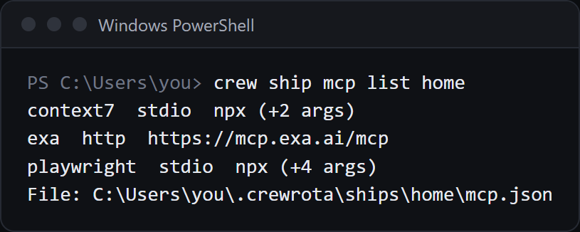

A ship is a folder in `<crew home>/ships/<ship>` that several members share: `projects`, `todos`, `file-history`, `session-env` and `shell-snapshots`, plus the ship's own `mcp.json`.
`crew ship join <member> <ship>` links a member's five folders to the ship, so its history, memory and MCP servers are the ship's.
Every subcommand runs without a terminal except `join` to a ship that does not exist and `delete` without `--yes`.

Ship names follow the member name rule: lowercase letters, digits and hyphens, starting with a letter, at most 32 characters.
A wrong subcommand prints `Usage: crew ship create|list|rename|delete|join|leave|mcp|import (see crew --help)` and exits with 1.

## crew ship create

Make an empty ship.

```sh
crew ship create <ship>
```

```text
$ crew ship create home

Created ship home: E:\demo-crew-pages2\crew-home\ships\home\projects

[exit code 0]
```

- It makes the five folders and `mcp.json`, seeded with a copy of the `mcpServers` in your `~/.claude.json` (an empty list when you have none). On macOS and Linux `mcp.json` is readable only by you (mode 0600).
- An existing ship fails with `Ship <ship> already exists`.

## crew ship list

Ships and their members.

```sh
crew ship list
```

```text
$ crew ship list

base: main, side
  E:\demo-crew-pages2\crew-home\ships\base\projects

[exit code 0]
```

With no ships it prints `No ships yet. Make one with: crew ship create <ship>`.

## crew ship join

Share a member's history through a ship.

```sh
crew ship join <member> <ship>
```

```text
$ crew ship join main home

main shares history through ship home.

[exit code 0]
```

- Each of the member's five folders becomes a link to the ship's folder: a junction on Windows, a symbolic link elsewhere.
- What the member already had is never deleted. A folder with files is moved aside to `<folder>.before-crewrota-<yyyymmdd>` and copied into the ship; a file whose name is taken in the ship arrives as `<name>.incoming-<n><ext>`. The note reads `[i] Copied this member's history into the ship. The original folder is kept at <folder>`.
- A ship that does not exist: in a terminal it asks `Ship <ship> doesn't exist. Create it? (Y/n)`; without one it fails:

```text
$ crew ship join team crew2

crewrota: Ship crew2 doesn't exist. Creating it needs a terminal. Make it first with: crew ship create crew2

[exit code 1]
```

## crew ship leave

Make a member isolated again.

```sh
crew ship leave <member>
```

```text
$ crew ship leave side

[i] side is isolated again. The ship's files stay in E:\demo-crew-inventory\crew-home\ships\home

[exit code 0]
```

Each link is replaced by an empty folder; the ship keeps every file.
A member on no ship prints `[i] <member> is not linked to a ship.`

## crew ship rename

Rename a ship; its members follow.

```sh
crew ship rename <old> <new>
```

```text
$ crew ship rename home base

Renamed ship home to base.

[exit code 0]
```

It renames the folder, saves the new name for each member, then re-points each member's links.
It fails when `<old>` does not exist or `<new>` is taken, and on Windows when a running session holds a file open in the ship.

## crew ship delete

Move a ship's folder to `removed/`.

```sh
crew ship delete <ship> [--force] [--yes]
```

| Flag | Default | What it does |
|---|---|---|
| `--force` | off | Delete a ship that still has members; they are unlinked first and become isolated |
| `--yes` | off | Do not ask; needed without a terminal |

```text
$ crew ship delete base --force --yes

Folder: E:\demo-crew-inventory\crew-home\ships\base
Members linked: main (unlinked first; they become isolated)
Session files: 0
Deleted ship base. Its folder is kept at E:\demo-crew-inventory\crew-home\removed\ship-base-20261104-1826

[exit code 0]
```

- Without `--force`, a ship with members fails: `Ship <ship> still has members aboard: <members>. Run crew ship leave <member> for each first, or pass --force.`
- Without `--yes` it asks `Delete ship <ship>? Its folder is moved to <crew home>/removed` (default No); without a terminal it fails with `Confirming the deletion needs a terminal. Pass --yes to delete without asking.`
- The folder goes to `removed/ship-<ship>-<yyyymmdd-hhmm>`. Nothing is deleted.

## crew ship import

Copy history and session folders from another folder into a ship.

```sh
crew ship import <ship> --from <folder>
```

| Flag | Default | What it does |
|---|---|---|
| `--from <folder>` | required | The folder to read. Each of the five folder names is looked for at `<folder>/<name>` and at `<folder>/continuity/<name>` |

```text
$ crew ship import home --from E:/demo-crew-pages2/old-history

projects         1 copied, 0 brought up to date, 0 already there, 0 kept beside a changed copy
todos            0 copied, 0 brought up to date, 0 already there, 0 kept beside a changed copy
Imported into ship home. E:/demo-crew-pages2/old-history was only read.

[exit code 0]
```

- The source is only read.
- New files are copied, the same file is skipped, a transcript that only grew in the source is brought up to date, and a file that changed on both sides arrives beside the ship's copy as `<name>.incoming-<n><ext>`.
- Run it again to bring in what is new.
- Errors: `Ship <ship> doesn't exist. Make it first with: crew ship create <ship>`, `<folder> is not a folder`, and `<folder> holds none of: projects, todos, file-history, session-env, shell-snapshots`.

## crew ship mcp list

The ship's MCP servers, without their keys.

```sh
crew ship mcp list <ship>
```

```text
$ crew ship mcp list home

docs  http  https://mcp.example.com/mcp
files  stdio  npx (+3 args)
File: E:\demo-crew-pages2\crew-home\ships\home\mcp.json

[exit code 0]
```

Each line is the name, the type and the URL without its query string, or `stdio`, the command and how many arguments it has.
Headers, environment values and URL queries are never printed, since that is where keys live.
An empty ship prints `Ship <ship> has no MCP servers. Add one with: crew ship mcp add <ship> <name> ...`.



## crew ship mcp add

Add an MCP server to a ship. Its members get it at their next launch.

```sh
crew ship mcp add <ship> <name> --url <url> [--transport <type>] [--header "Name: value"]...
crew ship mcp add <ship> <name> [--env KEY=value]... -- <command> [args]
crew ship mcp add <ship> <name> --from <.claude.json>
```

| Flag | Default | What it does |
|---|---|---|
| `--url <url>` | none | A remote server at this URL |
| `--transport <type>` | `http` | The server's `type` in `mcp.json`, for example `sse`; only with `--url` |
| `--header "Name: value"` | none | A request header; repeat it for more. Only with `--url` |
| `--env KEY=value` | none | An environment variable for a local server; repeat it for more |
| `-- <command> [args]` | none | A local (stdio) server: the command and its arguments |
| `--from <file>` | none | Copy the server named `<name>` from another config file's `mcpServers`, keys included; it must be the only flag |

A remote server with a header:

```text
$ crew ship mcp add home docs --url "https://mcp.example.com/mcp?key=SECRET" --header "Authorization: Bearer EXAMPLE"

Added docs to ship home. Its members get it at their next launch.

[exit code 0]
```

A remote server with another transport:

```text
$ crew ship mcp add home events --url https://mcp.example.com/sse --transport sse

Added events to ship home. Its members get it at their next launch.

[exit code 0]
```

A local server:

```text
$ crew ship mcp add home files --env ROOT=E:/demo-crew-pages2/proj -- npx -y @example/files-mcp E:/demo-crew-pages2/proj

Added files to ship home. Its members get it at their next launch.

[exit code 0]
```

A server from another config file:

```text
$ crew ship mcp add home docs --from E:/demo-crew-pages2/other.claude.json

Added docs to ship home. Its members get it at their next launch.

[exit code 0]
```

- Adding a name that is already there replaces that server.
- A header written in your shell needs quotes: `--header "Authorization: Bearer <key>"`.
- Errors: `Give either --url or a command after --, not both.`, `Give --url <url> for an HTTP server, or -- <command> [args] for a local one.`, `--header takes "Name: value".`, `--env takes KEY=value.`, `<flag> needs a value.`, `Could not read <file>: <reason>` and `<file> has no MCP server <name>`.
- At every launch the member's own `mcpServers` in its `.claude.json` is replaced by the ship's list, so a server added inside a member with `claude mcp add --scope user` is gone at its next launch. See [Give a ship's members the same MCP servers](../guides/mcp-servers.md).

## crew ship mcp remove

Remove one server from a ship. Its members lose it at their next launch.

```sh
crew ship mcp remove <ship> <name>
```

```text
$ crew ship mcp remove home files

Removed files from ship home. Its members lose it at their next launch.

[exit code 0]
```

A name the ship does not have fails with `Ship <ship> has no MCP server <name>` (exit 1).
For every `crew ship mcp` subcommand, a ship that does not exist fails with `Ship <ship> doesn't exist`.

## Related

- [Share history between members with a ship](../guides/ships.md)
- [Members, ships and your main setup](../concepts/members-and-ships.md)
- [Files and folders](files-and-folders.md)
