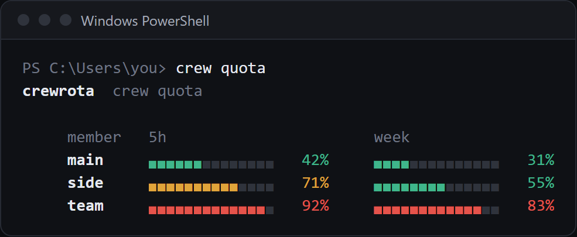
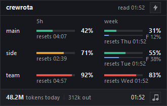
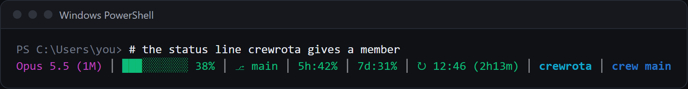

`crew quota` shows every member's 5-hour and week use as bars, `crew quota --format menubar` prints the same for a macOS menu bar app, `crew widget` keeps it on your desktop, and `crew statusline` is the status line crewrota gives a member that has none.
`crew warmup` is the only crewrota command that sends a message: one short Haiku message per member.
Every reading lands in the member's own `quota.json`.

## crew quota

Every member's usage as bars.

```sh
crew quota
```

No flags other than `--format menubar` below; anything else fails with `Usage: crew quota [--format menubar]` (exit 1).

```text
$ crew quota

crewrota  crew quota

     member   5h                       week
     main     ▖▖▖▖▖▖▖▖▖▖▖▖▖▖   86%     ▖▖▖▖▖▖▖▖▖▖▖▖▖▖   71%
     side     ▖▖▖▖▖▖▖▖▖▖▖▖▖▖   12%     ▖▖▖▖▖▖▖▖▖▖▖▖▖▖   34%
     team     ▖▖▖▖▖▖▖▖▖▖▖▖▖▖   47%     ▖▖▖▖▖▖▖▖▖▖▖▖▖▖   62%

[exit code 0]
```



- Unless `crew config refresh off` is set, it first reads every member's usage with quota-axi, one call per member, side by side. quota-axi sends no message. A member whose reading fails keeps its last one.
- In a terminal the filled part of each bar is coloured: green under 60%, amber from 60%, red from 80%. Piped, the output has no colour, so only the percentages carry the numbers.
- A member with no reading shows `no reading yet`; a window whose reset time has passed shows 0%.
- With no members it prints `No crew members yet. Add one with: crew add <member>`.
- It has no `--json`; a script reads each member's `quota.json` instead (see [Files and folders](files-and-folders.md#quotajson)).

## crew quota --format menubar

The same readings as SwiftBar and xbar text.

```sh
crew quota --format menubar
```

```text
$ crew quota --format menubar

crew 30%
---
main | font=Helvetica-Bold
5h 30%  resets 09:03 | color=#3fb68b
week 55%  resets Wed 09:03 | color=#3fb68b
side
5h 30%  resets 09:03 | color=#3fb68b
week 55%  resets Wed 09:03 | color=#3fb68b
team
5h 30%  resets 09:03 | color=#3fb68b
week 55%  resets Wed 09:03 | color=#3fb68b
---
Open the crew menu | shell="C:\Program Files\nodejs\node.exe" param1="E:\Projects\startup\crewrota\dist\cli.js" terminal=true
Refresh | refresh=true

[exit code 0]
```

- The first line is `crew <N>%`, the current member's 5-hour use, or `crew` when there is no reading.
- Each member's name (bold for the current one), then a `5h` and a `week` line with the reset time and a colour: `#3fb68b` under 60%, `#e0a43a` from 60%, `#e5534b` from 80%.
- The last two lines open the crew menu in a terminal and refresh the plugin.
- It never checks usage: it reads `quota.json` only, because a menu bar app runs it every minute.
- `widget/crewrota.1m.sh` in the package runs it. See [Show usage in the macOS menu bar](../guides/macos-menu-bar.md) (beta).

## crew warmup

Send each member one short message, which starts its 5-hour window if none is running, then show the bars.

```sh
crew warmup [<member>...]
```

| Argument | Default | What it is |
|---|---|---|
| `<member>...` | every member | Only these members |

```text
$ crew warmup team

[i] Each member gets one short message (Haiku), which starts its 5-hour window if none is running.
crewrota  crew quota

     member   5h                       week
     main     ▖▖▖▖▖▖▖▖▖▖▖▖▖▖   30%     ▖▖▖▖▖▖▖▖▖▖▖▖▖▖   55%
     side     ▖▖▖▖▖▖▖▖▖▖▖▖▖▖   30%     ▖▖▖▖▖▖▖▖▖▖▖▖▖▖   55%
     team     ▖▖▖▖▖▖▖▖▖▖▖▖▖▖   12%     ▖▖▖▖▖▖▖▖▖▖▖▖▖▖   48%

[exit code 0]
```

- It is the only crewrota command that sends a message, and it counts against each member's quota.
- Per member it runs `claude -p ok --model haiku --output-format stream-json --verbose --no-session-persistence --setting-sources project --strict-mcp-config --disable-slash-commands` in the system temp folder with `CLAUDE_CONFIG_DIR` at the member's folder. The run is saved nowhere and loads none of the member's settings, hooks or MCP servers.
- It stops each run as soon as Claude Code reports the usage, and gives up on a member after 30 seconds.
- An unknown member fails before anything is sent: `Crew member ghost doesn't exist. Create it with: crew add ghost` (exit 1).

## crew widget

Open the quota widget: every member's bars in a small always-on-top window.

```sh
crew widget
```

```text
[OK] The widget is open. Its bolt warms up every member; right-click it to refresh or quit; close it with: crew widget close
```

When it is already open: `[i] The widget is already open. Close it with: crew widget close`.



- It needs Python 3 with Tk. crewrota looks for `pythonw`, then `pyw` on Windows, and `python3` elsewhere; `CREWROTA_PYTHON` names another. Without one it fails with `The widget needs Python 3 with Tk (the python.org installer includes both). Install it, then try again.`
- It starts `widget/crewrota-widget.pyw` detached, so the terminal is free at once.
- The widget redraws every 30 seconds, dims a reading older than six hours, and sums today's tokens from every member's transcripts. Its bolt, and Warm up all in its right-click menu, run `crew warmup` for every member; Refresh redraws it and Quit closes it.
- It writes `widget.pid` while open and `widget.json` (its position) in the crew home.

More in [Keep usage on your desktop with the widget](../guides/widget.md).

## crew widget close

```sh
crew widget close
```

It asks the widget to close through a `widget.close` file in the crew home and waits up to 5 seconds.

| Output | Exit code |
|---|---|
| `[OK] Closed the widget.` | 0 |
| `[i] The widget is not open.` | 0 |
| `[!] The widget did not close within 5 seconds. Right-click it and pick Quit.` | 1 |

## crew widget startup

Open the widget when you log in to Windows, or stop that.

```sh
crew widget startup on
crew widget startup off
```

```text
$ crew widget startup on

[OK] The widget opens at login, from E:\demo-crew-pages2\appdata\Microsoft\Windows\Start Menu\Programs\Startup\crewrota widget.lnk

[exit code 0]
```

```text
$ crew widget startup off

[OK] The widget no longer opens at login.

[exit code 0]
```

- `on` writes `crewrota widget.lnk` in `%APPDATA%\Microsoft\Windows\Start Menu\Programs\Startup` through PowerShell, pointing at the Python it found. `off` deletes it.
- On macOS and Linux it fails with `Opening the widget at login is Windows-only for now; macOS gets a menu bar item later.`
- Any other `crew widget` argument fails with `Usage: crew widget | crew widget close | crew widget startup on|off`.

## crew statusline

The status line crewrota gives a member that has none of its own.

```sh
crew statusline
```

You do not run it yourself: Claude Code runs it and pipes the session's JSON to it.
At launch, a member whose `settings.json` has no `statusLine` gets this entry:

```json
{
  "statusLine": {
    "type": "command",
    "command": "crewrota statusline"
  }
}
```

A member that already has a status line, its own or one copied from your main setup, keeps it; a linked or unreadable `settings.json` is left alone.

Output, with `NO_COLOR` set and a sample session JSON on stdin:

```text
$ echo <session JSON> | CLAUDE_CONFIG_DIR=<crew home>/members/team NO_COLOR=1 crew statusline

Opus 5.5 (1M) | ███░░░░░░░ 37% |  main | 5h:42% | 7d:63% | ↻ 15:30 (0m) | crewrota | crew team
[exit code 0]
```



- The parts: the model, the context bar, the git branch, `5h:` and `7d:` use, the 5-hour reset with a countdown, the folder name, and `crew <member>` (the name of the folder in `CLAUDE_CONFIG_DIR`).
- Colours: green under 50%, yellow from 50%, red from 80%. `NO_COLOR` turns colour off and joins the parts with ` | `.
- With `CLAUDE_CONFIG_DIR` set it saves the session's `rate_limits` to `quota.json` in that folder; an older session never overwrites a newer reading.
- It never fails: bad or missing input prints what it can and exits with 0.

## Related

- [Check every member's usage](../guides/usage-and-quota.md)
- [Where usage readings come from](../concepts/usage-readings.md)
- [Files and folders: quota.json](files-and-folders.md#quotajson)
