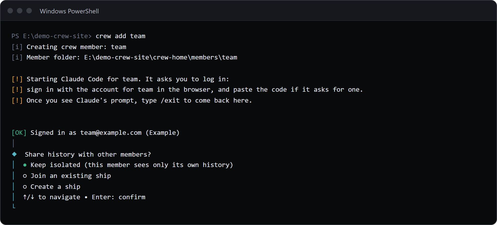
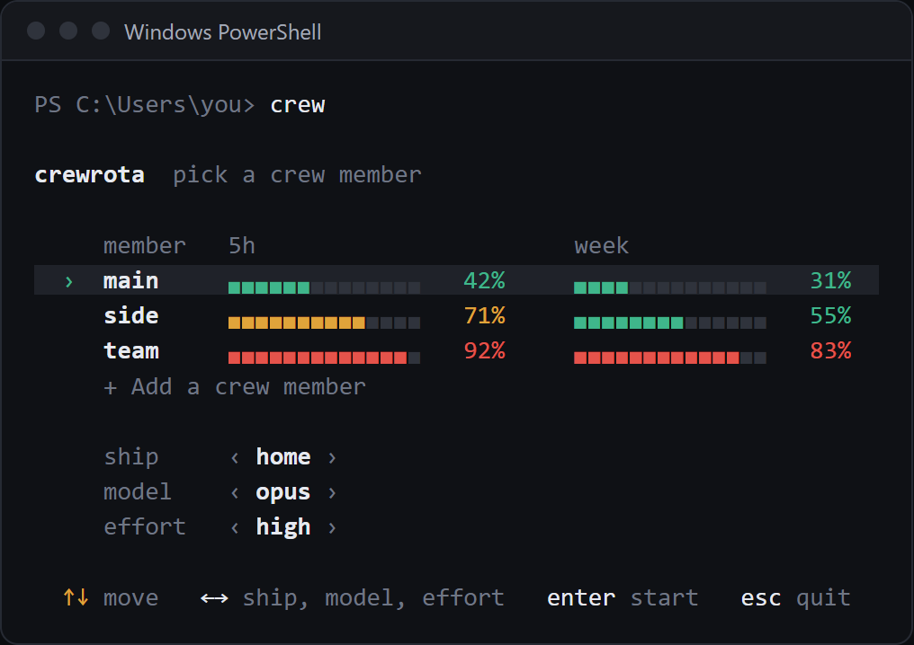
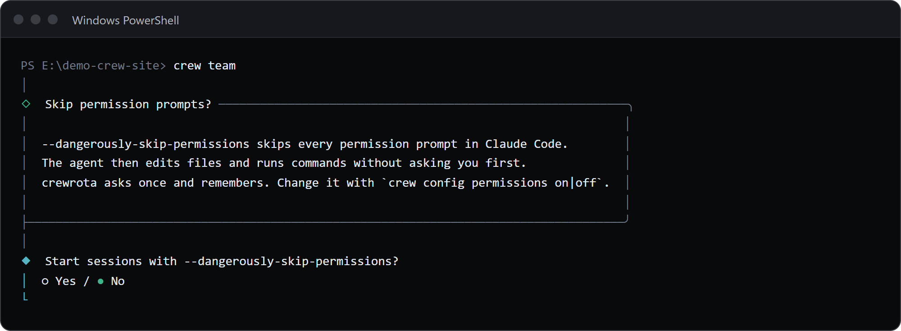

Windows is crewrota's main platform.
Steps 1 to 5 give you a working crew: install Claude Code, Node.js and crewrota (`npm install -g crewrota`), add your members with `crew add <member>`, then start Claude with `crew`.
Steps 6 to 9 and the VS Code shortcuts are optional.
Run the commands in PowerShell.

## 1. Install Claude Code

```powershell
irm https://claude.ai/install.ps1 | iex
```

Or with winget:

```powershell
winget install Anthropic.ClaudeCode
```

Check it with `claude --version`.

## 2. Install Node.js 22.19 or newer

Download it from https://nodejs.org/en/download, then open a new PowerShell window and check it with `node --version`.

## 3. Install crewrota

```powershell
npm install -g crewrota
```

`crew`, `crw` and `crewrota` are then known commands in every terminal, all the same command.
Run it again to update. Remove it with `npm uninstall --global crewrota`.
Check the setup with `crew doctor`.

From source: in the crewrota folder, in PowerShell:

```powershell
powershell -ExecutionPolicy Bypass -File .\scripts\install.ps1
```

`-ExecutionPolicy Bypass` applies to that one run only; Windows blocks `.ps1` scripts by default.

It checks for Node 22, builds crewrota, packs it the way it would be published, and installs that package globally.
Run the script again after pulling changes to update.

## 4. Add your crew members

```powershell
crew add main
```

crew makes the folder `%USERPROFILE%\.crewrota\members\main` and starts Claude Code inside it, so you sign in with Claude Code's own login in your browser.
Paste the code if it asks for one, and type `/exit` once you see Claude's prompt.
Your main `~/.claude` login is not touched.
Then crew shows the email and organisation it logged in as, and asks one question:

- "Share history with other members?" Keep it isolated (the default), join an existing ship, or create a ship.



Every member gets your skills, agents, commands, plugins, settings and `CLAUDE.md` from `~/.claude` before every launch, and its MCP servers from its ship (`crew ship mcp list <ship>`).

Add as many members as you have accounts, for example `crew add side`.
For an account that signs in with single sign-on, use `crew add side --sso`; `--email <address>` passes that email to Claude Code's login.
`crew use <member>` also offers to create a member that does not exist yet.
If two members sign in to the same account, crew warns you; see [Add and manage crew members](../guides/members.md).

## 5. Share history, then start Claude

To let two members see each other's sessions (`--resume`), put them on one ship:

```powershell
crew ship join main home
crew ship join side home
```

```text
main shares history through ship home.
```

crew asks before it creates a ship that does not exist, and copies each member's existing history into it.

Then start Claude:

```powershell
crew
```



The menu shows your members with their 5-hour and weekly bars, and the ship, model and effort below them.
Up and down (or 1 to 9) pick the member, tab picks the ship, the model or the effort, left and right change it, enter starts, esc quits; each member starts on its own ship and its last model and effort.
The bars show each member's last reading and fill after its first session. Each time the menu opens it reads them fresh with quota-axi, one call per member side by side, and sends no message; `crew config refresh off` stops that, and the bars then show each member's last reading.
`crew warmup` sends each member one short Haiku message, which starts its 5-hour window if none is running. It is the only crewrota command that sends a message.
Or skip the menu with `crew main` (short for `crew run main`), or make one member the default with `crew use main` and run `crew run`.
Claude's own flags go after `--`: `crew main -- --resume <id>`.

At your first launch crewrota asks once whether sessions should start with `--dangerously-skip-permissions` (default no):



If something is missing, `crew doctor` says what and how to fix it.

## 6. Keep the bars on your desktop

```powershell
crew widget                  # open it; drag it anywhere, the bolt warms up every member, right-click to refresh or quit
crew widget close            # close it
crew widget startup on       # open it at every login (off removes that)
```

The widget is a small always-on-top window with every member's 5-hour and week bars, read from the same files as `crew quota`.
Its footer shows today's tokens across the crew (from the members' session transcripts), the clock and a link to a coding-music stream.
It needs Python 3 with Tk; the python.org installer includes both.
More in [Keep usage on your desktop with the widget](../guides/widget.md).

## 7. Install the default tools and the plugin

```powershell
crew setup
```

It lists each tool (the lavish, gh-axi and quota-axi skills, treehouse, Playwright CLI, and the Playwright MCP entry for each ship) with the exact command it runs and where it lands, then asks once.
Anything already installed is skipped.
It also asks whether lavish-axi may send usage telemetry, and checks `gh auth status` without signing you in.
`crew doctor` shows what is still missing.

Then add the plugin in your main Claude Code (not inside a member; members pick it up at their next launch):

```powershell
claude plugin marketplace add pasindu-premachandra/crewrota
claude plugin install crewrota@crewrota
```

## 8. Set up a project and run firstmate

In the project's folder:

```powershell
crew init
```

It writes `.claude\` (`crewrota.json`, a short `CLAUDE.md` if the project has none, `memories\`, `skills\`, `tasks\INDEX.md`) and never overwrites a file.
Then start Claude in that folder and hand it a task: `/firstmate <what you want done>`.

## 9. Moving to a new machine

On the old machine:

```powershell
crew backup --password
```

It writes one zip, for example `crewrota-backup-20261026-0905.zip`, with your ships, members, settings, skills and every project's `.claude` (tasks, evidence, memories), encrypted with the password you type twice. Add `--dry-run` first to see what goes in.
Logins are never in it.
Copy the zip to the new machine, install crewrota there (steps 1 to 3), then:

```powershell
crew restore .\crewrota-backup-20261026-0905.zip --password
```

The restore renames your projects' session folders when your user folder differs; add `--map E:\Projects=D:\work` for projects that moved elsewhere, and `--clone` to fetch each repo's code from GitHub.
It ends with one `crew login <member>` line for each member; run each one to sign that member in again.
More in [Move your crew to a new machine](../guides/backup-and-restore.md).

## VS Code shortcuts (optional)

```powershell
crew shortcut add site --member main --folder E:\code\site --hotkey CTRL+ALT+C
crew shortcut list
crew shortcut open site
```

A shortcut opens a folder in VS Code and runs `crew <member>` there as a task, in an editor tab; when the session ends, the tab stays open as a shell in that folder.
`add` writes `site.code-workspace` under `%USERPROFILE%\.crewrota\shortcuts` and a `site` entry in the Start Menu, which the hotkey also opens; VS Code brings back that window's layout and its other terminals each time, even when only that window was closed.
Change one with `crew shortcut set`, remove one with `crew shortcut remove`; `crew rename` and `crew drop` carry a member's shortcuts along.
More in [Open a folder as a member from VS Code](../guides/vscode-shortcuts.md).

## Next

- [Your first crew in five minutes](../first-crew.md)
- [Fix a problem with crew doctor](../guides/troubleshooting.md)
- [Every command](../commands.md)
